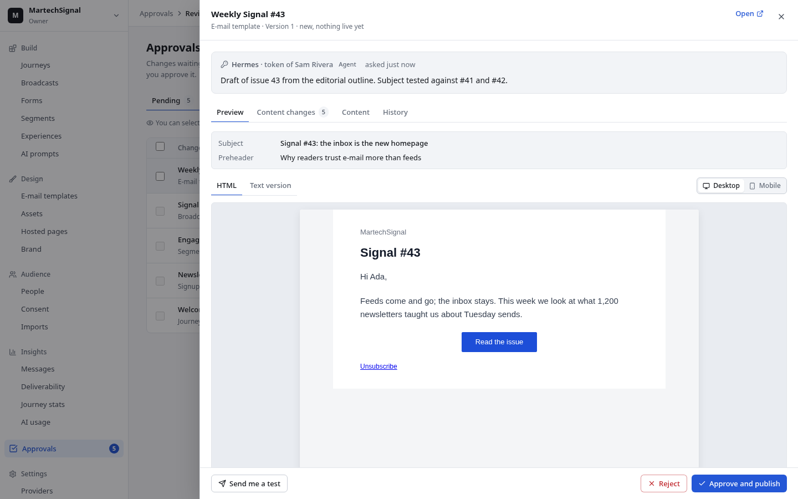

# Agentic Marketing

An open-source, self-hostable marketing platform built **agent-first**: every capability is a command that works the same over REST, MCP (for AI agents) and the web UI, under the same permissions, approvals and audit log. Underneath is an event-based customer data platform with GDPR-grade consent handling. You bring your own LLM keys.

It runs as one Docker image (a TypeScript modular monolith) next to Postgres, ClickHouse, NATS and Valkey, and is sized for a team of one up to a few million profiles.

## What it does



- **An admin UI built for reviewing agents' work:** an approval drawer that shows the actual e-mail, form, journey, segment or broadcast with what changed and who asked; a journey builder with drag and drop; template, form, segment and brand editors; an asset library; light and dark themes; keyboard access throughout. Screens are in [docs/design/screenshots](docs/design/screenshots).

- **Collect events:** Segment-compatible ingest (`/v1/batch`), a browser SDK, per-source consent rules, a tracking plan, bot filtering.
- **Consent banner:** in the SDK, CSP-safe, with texts from your purposes and Google Consent Mode v2 signals. Ad click ids (`gclid`, `fbclid`, `msclkid`…) are kept only with `ad_measurement` consent.
- **Know people:** identity resolution and merges, profiles with traits and events, a consent ledger per purpose, export and erasure (DSR).
- **Segments:** conditions on traits, events, consent and other segments, recomputed continuously, with enter and exit events. Whole-segment refreshes run as SQL in Postgres and ClickHouse, load-tested to a million profiles. A segment can also be a static list (added by hand, by id or e-mail, or imported from CSV) or a snapshot of another segment.
- **E-mail:**
  - MJML and Liquid templates with preview, test sends and UTM tagging;
  - a send gateway that checks lawful basis, consent, objections and suppressions;
  - providers SES, Postmark, Brevo, Cloudflare Email Service or SMTP, with delivery, bounce, complaint and click events;
  - a domain check for SPF, DKIM and DMARC;
  - one-click unsubscribe (RFC 8058).

  What happens to an e-mail becomes a customer event (`Email Link Clicked`…), so segments, journeys and webhooks can use it.
- **SMS:** Twilio, with consent per purpose, STOP/START/HELP replies, delivery reports, a segment and cost preview, and a monthly budget. SMS works in journeys and broadcasts.
- **Push:** web push (VAPID, encrypted payloads) for browsers, FCM for Android and APNs for Apple apps, with the same consent and delivery policy; in journeys and broadcasts.
- **Delivery policy:** for marketing messages on every channel:
  - frequency caps;
  - quiet hours in each person's time zone;
  - an automatic pause when bounce or complaint rates pass the limits.
- **Newsletter:** signup forms with double opt-in (works without JavaScript, optional Cloudflare Turnstile), subscriber import with consent proof (from Kit, Mailchimp…), broadcasts to a segment. Issues are built from reusable e-mail blocks and checked before they go out; readers choose topics on a preference centre; every issue has a signed web version and can go into a public archive with RSS; subject tests pick the winning subject line; send windows hold each message until the reader's local window opens.
- **Campaigns:** groups broadcasts, journeys, templates, experiences, forms and segments under one goal and a shared UTM campaign, with an attribution window, per-member results and a campaign report. Journeys and campaigns can hold out a control group and report the measured uplift.
- **Measurement and alerts:** a read-only metric layer (`analytics.query`, named reports, Insights → Analytics) answers questions over a fixed catalogue of measures and dimensions, with no SQL or table names as input. Threshold alerts watch deliverability, signup drops and journey errors, and notify a signed webhook or workspace members by e-mail.
- **Journeys:** a visual builder and an engine with waits, branches, e-mail, SMS, push, webhooks, connector actions and AI steps (decide, generate) with fallbacks; a wait-until step holds a person until a segment condition matches, an event trigger can enter people once per business key, and people can be moved onto a new version.
- **Web personalization:** experiences and A/B tests served by a decision API (or at the edge, by a Cloudflare Worker), with an anti-flicker snippet, consent-aware targeting, a visual composer, preview links and sequential or Bayesian results.
- **AI:** your own providers (Anthropic, OpenAI, Ollama…), metering and budgets that hold under concurrency, prompt artifacts with test runs, redaction, a decision log with sampled human reviews, text classification, generated text cached per segment, and an in-app copilot over MCP that streams its answers and keeps conversations.
- **Performance marketing:**
  - conversions to Meta (Conversions API), Google Ads (Data Manager API), Microsoft Advertising, LinkedIn, TikTok and Pinterest, from a conversion map, for people who allowed `ad_measurement`;
  - segments synced to Meta custom audiences and Google Customer Match, with `ad_targeting` consent and removals when people leave, withdraw or are erased;
  - spend import with CPA and ROAS per campaign from first-party attribution.

  Identifiers are hashed, test modes are built in, and uploads are listed in each person's data export. Agents read and draft; budgets and bids stay with people.
- **Integrations:**
  - signed outbound webhooks;
  - a connector SDK (Shopify, Slack, HTTP, and OAuth 2.0 APIs with automatic token refresh);
  - inbound hooks;
  - API tokens (for n8n and scripts);
  - warehouse export to Postgres or S3-compatible storage (for BigQuery, Snowflake…), without personal data, with erasures;
  - rate limits shared across workers.
- **Governance:**
  - everything an agent builds is a versioned artifact (journey, segment, template, form…) with drafts, diffs and approval policies;
  - config as code: artifacts in git, promoted from staging to production through the same approvals;
  - single sign-on (OIDC, SAML) and SCIM provisioning;
  - audit log;
  - encrypted secrets with key rotation, the key in the environment, OpenBao/Vault or AWS KMS;
  - Postgres row-level security and ClickHouse row policies per workspace;
  - retention jobs.

## Quick start (Docker)

Download `agentic-marketing-compose-<version>.tar.gz` from the [latest release](https://github.com/TimChr78/Agentic-Marketing/releases) (no checkout needed), then:

```bash
tar xzf agentic-marketing-compose-<version>.tar.gz && cd agentic-marketing-compose-<version>
# writes .env with generated secrets (never printed) and asks for the public URLs
docker run --rm -it -v "$PWD:/work" -w /work --user "$(id -u):$(id -g)" \
  ghcr.io/timchr78/agentic-marketing:<version> am init
docker compose up -d        # pulls the released image
docker compose exec app am bootstrap --email you@example.com --workspace 'My site'
docker compose exec app am doctor   # configuration, services, sending domains
```

In a checkout, `pnpm --silent --filter @agentic-marketing/server cli init` does the same. Never edit `docker-compose.yml`: site-specific settings go in `compose.override.yaml` (see [`compose.override.example.yaml`](compose.override.example.yaml) and [the Compose guide](docs/deployment/compose.md)), so an upgrade replaces the release file and nothing else.

`AM_VERSION` (default `0.3.0`) selects the released image `ghcr.io/timchr78/agentic-marketing`. Pin a version instead of `latest` so restarts and `docker compose pull` do not silently change what runs. `AM_PORT` (default `3000`) is the published host port: the app still listens on 3000 inside the container, so keep `PUBLIC_URL` and `PUBLIC_LINKS_URL` in step with it. ClickHouse is capped at `CLICKHOUSE_MEM_LIMIT` (default `2g`), which covers the whole container (server, caches and query memory); ClickHouse's own limits such as `max_server_memory_usage` still apply inside it, and 2g is a starting point for the single-node pilot.

To build from source (development, CI or a local patch) use the overlay:

```bash
docker compose -f docker-compose.yml -f docker-compose.build.yml up -d --build
```

It tags the local image `agentic-marketing:local` (set `AM_BUILD_IMAGE` for another tag); the default compose file only pulls the release image.

The bootstrap command prompts for the password without echoing it. In a script, set `AM_BOOTSTRAP_PASSWORD` and pass it through (`docker compose exec -e AM_BOOTSTRAP_PASSWORD app am bootstrap …`) or pipe one line on stdin (`… | docker compose exec -T app am bootstrap …`). `--password` still works but is deprecated: arguments are visible in process listings and shell history. Change the password later with `am reset-password --email you@example.com` (again via `AM_RESET_PASSWORD`, a hidden prompt, or stdin).

Open http://localhost:3000 for the admin UI (it is built into the image and served at `/`), sign in, and add an e-mail provider. To let an AI agent work in the workspace, connect an MCP client (Claude, an IDE…) to `http://localhost:3000/mcp`: it registers itself, and you choose its permissions on the consent page.

MCP requires `PUBLIC_URL` to be HTTPS. With a plain-HTTP address on a LAN the admin UI and REST API still work, but MCP/OAuth client endpoints are disabled; expose the server over HTTPS (e.g. with Tailscale or a Cloudflare Tunnel) to enable MCP.

Running it behind a proxy or a Cloudflare Tunnel: set `PUBLIC_URL`, `PUBLIC_LINKS_URL`, `CLIENT_IP_HEADER` (an ordered list, e.g. `cf-connecting-ip,x-forwarded-for`) and `TRUSTED_PROXY_CIDRS` for the tunnel/proxy ranges (see [`.env.example`](.env.example)). Set `PUBLIC_PORT` (e.g. `3001`) to add a public-only listener (`/f`, `/u`, `/c`, `/a`, `/n`, `/hooks`, `/healthz`, `/readyz`) and point the tunnel there, so no path rule is needed: a tunnel on the Compose network uses `http://app:3001`; for one on another host, publish it with `PUBLIC_BIND=0.0.0.0:3001`. Admin LAN traffic without a forwarding header uses the socket address.

The compose file keeps Postgres, ClickHouse and NATS data in named volumes. To use host directories instead, add bind mounts in `compose.override.yaml` (see `compose.override.example.yaml`, never edit `docker-compose.yml`). The containers run as their own users (Postgres uid 70 in the Alpine image, ClickHouse uid 101; NATS runs as root), so `chown` the host directories to match or the services will fail to write; named volumes avoid that.

On Kubernetes: the Helm chart in [`deploy/helm`](deploy/helm/agentic-marketing) runs each role as its own Deployment; see the [reference deployment](docs/deployment/kubernetes.md).

## Documentation

- [Development](docs/development.md): layout, running locally, tests, key rotation.
- [Kubernetes reference deployment](docs/deployment/kubernetes.md): Helm, OpenBao or AWS KMS keys, sizing.
- [Docker Compose deployment](docs/deployment/compose.md): the release files, the override file, upgrades.
- [Operations](docs/deployment/operations.md) (`am init`, `am doctor`), [backups and restore](docs/deployment/backups.md) and [post-upgrade checks](docs/deployment/smoke.md) (`am smoke`).
- [Edge decisions](docs/deployment/edge.md): the decision API on Cloudflare Workers.
- [Push notifications](docs/push.md): browsers, Android and Apple apps.
- [Single sign-on, SCIM and agent permissions](docs/identity.md).
- [Architecture](docs/architecture/README.md) and its [ADRs](docs/architecture/adr/).
- [Integrations](docs/integrations.md): webhooks, connectors, n8n, config as code, warehouse export.
- [Pilot: MartechSignal](docs/pilots/martechsignal.md): replacing Kit on a static Cloudflare Pages site.
- Agent skills in [`.claude/skills/`](.claude/skills/):
  - `agentic-marketing-implement`: rolling the stack out on a website;
  - `agentic-marketing-mcp`: operating a workspace over MCP.

## Releases and upgrading

Releases are on [GitHub](https://github.com/TimChr78/Agentic-Marketing/releases), with the image `ghcr.io/timchr78/agentic-marketing:<version>` (linux/amd64 and linux/arm64), the packaged Helm chart, the Compose bundle (`docker-compose.yml`, `.env.example`, `compose.override.example.yaml`, [`UPGRADING.md`](UPGRADING.md)) and `SHA256SUMS`; what changed is in the [changelog](CHANGELOG.md). `/healthz`, MCP `serverInfo`, OpenAPI, `workspace.get` and Settings → Workspace show the running version. The current release is **0.3.0**, a pre-release. A release is made by pushing a version tag, or by running the Release workflow (Actions → Release → Run workflow) with the version, which tags the current `main`.

Upgrading: follow [UPGRADING.md](UPGRADING.md), and read the release's **Upgrading from** block, which always lists migrations, configuration, breaking changes, manual steps and the one-line upgrade. Database migrations run when the server starts, and only move forward: the app takes a Postgres backup to the `backups` volume before it migrates (unless `SKIP_PRE_UPGRADE_BACKUP=true`), and `am backup` / `am restore` do it by hand ([backups](docs/deployment/backups.md)). With `SKIP_MIGRATIONS=true` (several replicas, Kubernetes) run `cli migrate` first; the Helm chart does this in a Job before each upgrade. After an upgrade, `am smoke` checks the public host the way visitors and agents see it. While the version is 0.x, commands and artifact formats may still change.

Security problems: see [SECURITY.md](SECURITY.md).

## Status and roadmap

Wave 1 (Phases −1 to 5) is complete: foundations, data platform, e-mail, segments, journeys, personalization, AI and integrations.

[Wave 2](docs/architecture/roadmap-wave-2.md):

| Phase | Theme | State |
|---|---|---|
| 6 | Pilot live and hardening | The code items are done: e-mail events on profiles, retention, UTM tagging, test sends, Docker smoke test. 0.2.0 replaced the admin UI (navigation, approvals, journey builder, assets, brand). The MartechSignal run is next. |
| 7 | Delivery beyond SMTP, and SMS | Done: Cloudflare Email Service adapter, delivery policy (caps, quiet hours, auto-pause), deliverability health and domain check, Twilio SMS. Later: GatewayAPI, SMS double opt-in, provider warm-up |
| 8 | Consent everywhere | Done: consent banner with Consent Mode v2, ad purposes, click-id capture, OAuth 2.0 connections, shared rate limits, bot filtering |
| 9 | Performance marketing | Done: conversions (Meta, Google, Microsoft), audience sync (Meta, Google), spend and ROAS. Later: Microsoft reporting and audiences, more platforms |
| 10 | Scale and operations | Done: correctness (AI budget reservations, prompt test jobs, merge-safe journeys, journey version migration, instant experience updates), scale (segments evaluated in SQL, ClickHouse row policies, a load test to 1M profiles), operations (Helm chart, OpenBao and AWS KMS keys, warehouse export, config as code) |
| 11 | Enterprise and ecosystem | Part a done (single sign-on with OIDC and SAML, SCIM provisioning, MCP scope step-up). Part b done (AI: classify, text per segment, review samples, a streaming copilot with stored conversations). Part c done (sequential and Bayesian experiment statistics, edge decide on Cloudflare Workers, a visual composer and preview links). Part d done (push: web push, FCM, APNs). Part e done (Salesforce, the Shopify app with customer import, conversions to LinkedIn, TikTok and Pinterest) |

[Wave 3](docs/architecture/roadmap-wave-3.md), from the open issues:

| Phase | Theme | State |
|---|---|---|
| 12 | Install and upgrade | Done in 0.2.4–0.2.5: Compose bundle per release, compose defaults, `am init` / `doctor` / `smoke`, backups and restore, the running version everywhere |
| 13 | Pilot correctness | Done in 0.2.6: consent exits from journeys, approval bundles, fast confirmation retries, layout-only journey edits |
| 14 | Admin UI for daily use | Done in 0.2.7: pages use the window, live journey stats, structured editors, server-side list filters |
| 15 | Newsletter and lifecycle e-mail | Done in 0.2.8: preference centre, archive and web version, content blocks, pre-send checks, subject tests, send windows, static audiences, wait until and entry keys |
| 16 | Measure and report | Done in 0.2.9: metric layer, campaigns, holdouts, alerts |

[Wave 4](docs/architecture/roadmap-wave-4.md), agentic marketing (designed in [agentic-autonomy.md](docs/architecture/agentic-autonomy.md)): agents that run whole marketing loops within borders a person sets, enforced by the platform.

| Phase | Theme | State |
|---|---|---|
| 17 | Agent controls | Built in 0.3.0: agents as principals with a pause button, a policy engine with limits and impact estimates, the action ledger, Settings → Agents (still open: #144, #207) |
| 18 | Mandates and the first autonomy | Planned: mandates with levels, holds with veto windows, the pilot's autonomous weekly newsletter |
| 19 | The safety net | Planned: the guardian, staged sends, undo, shadow mode |
| 20 | Closed loops | Planned: full loops, goals and attribution, learnings, the campaign, newsletter and lifecycle programmes |
| 21 | Hosted agents | Planned: the full runtime for agents inside the platform (a thin version with reports and a deliverability guardian ships in Phase 19) |
| 22 | Many agents, many brands | Planned: coordination, brand scoping, progressive rollout, ad audiences (agent-managed spend needs its own design, #212) |

## Development

```bash
pnpm install
pnpm lint && pnpm typecheck && pnpm test   # tests need Postgres, ClickHouse, NATS and Valkey
scripts/smoke.sh                           # the Docker image end to end
pnpm --filter @agentic-marketing/server cli loadtest --profiles 1000000   # segment refreshes at scale
pnpm dev:web                               # the admin UI on :5173 against the API (demo at /demo)
npx tsx apps/server/test/e2e/server.ts     # a seeded workspace on :3100 for UI work
pnpm e2e                                   # Playwright end-to-end tests of the UI
```

See [docs/development.md](docs/development.md) for details.

## License

[MIT](LICENSE).

