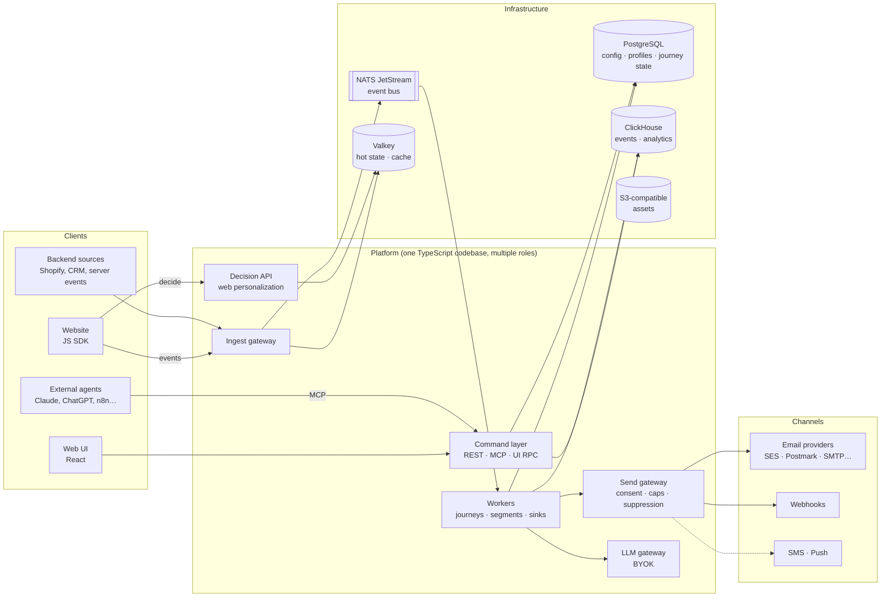

# Architecture — Agentic Marketing Platform

> Status: **Draft v0.1** — architecture & technology selection, before development starts.
> Everything here is a proposal; decisions are recorded as ADRs in [`adr/`](adr/) and can be overturned.

## What we are building

An open-source, self-hostable, **event-driven marketing platform built agent-first**:

- Every capability is exposed through one command layer that powers the **REST API, the MCP server and the UI** alike — agents and humans use the same surface.
- **Channels:** email and web personalization first, webhooks next, SMS and push later — all behind pluggable adapters.
- **Near real-time:** web events are ingested, resolved to a profile and can trigger journeys and in-session personalization within seconds (sub-second for the hot path).
- **Customer data platform:** profiles, identity resolution, event store, segments, consent.
- **Human-friendly builders:** a visual journey canvas (Salesforce Journey Builder / n8n style), a visual MJML email editor, an experience editor for web personalization.
- **Versioning & approvals:** every journey, template, segment and experience is a versioned artifact with an optional, configurable approval pipeline.
- **EU / GDPR first:** consent and legitimate-interest ledger enforced at every send, crypto-shredding for erasure, PII-aware LLM usage, bring-your-own LLM keys.

## Constraints that shape everything

| Constraint | Consequence |
|---|---|
| Team of one, no deadline, maintainability first | Modular monolith in **one language (TypeScript)**, one container image, few infrastructure components, boring tech where possible. |
| Free & open-source core, self-hostable | Only permissively licensed dependencies (MIT / Apache-2.0 / BSD / MPL / PostgreSQL). `docker compose up` must give a working system. |
| Private use now, 10M profiles + multi-tenant SaaS later | `workspace_id` on every row and every event **from day one**; stateless services that scale horizontally; storage choices that are proven at 10M+ profiles. |
| Agents are first-class users | Command registry with typed schemas → REST + MCP + UI from one definition; drafts/approvals for agent writes; dry-run & simulation tools. |
| EU / GDPR | Consent & lawful-basis enforcement in a single send gateway; data minimization; erasure that also covers the event store and backups. |

## Document map

| Document | Contents |
|---|---|
| [overview.md](overview.md) | System context, containers, main data flows, module boundaries |
| [data-platform.md](data-platform.md) | Event ingestion, profiles, identity resolution, event store, segments |
| [journeys-and-editors.md](journeys-and-editors.md) | Journey engine, flow canvas, email editor, versioning & approvals |
| [channels-and-personalization.md](channels-and-personalization.md) | Send gateway, channel adapters, web personalization / decision API, integrations |
| [agents-and-mcp.md](agents-and-mcp.md) | Command registry, MCP server, LLM gateway (BYOK), AI journey steps, guardrails |
| [security-and-privacy.md](security-and-privacy.md) | GDPR, consent & legitimate interest, encryption, erasure, authz, threat model |
| [tech-stack.md](tech-stack.md) | Technology selection matrix with alternatives and licenses |
| [deployment-and-scaling.md](deployment-and-scaling.md) | Self-host topology, scaling path to 10M profiles and multi-tenant SaaS |
| [roadmap.md](roadmap.md) | Phased delivery plan for a team of one |
| [open-questions.md](open-questions.md) | Decisions still needed from the product owner |
| [adr/](adr/) | Architecture Decision Records |

## The architecture in one picture

## Headline decisions

1. **Build a new core, using Dittofeed as a reference rather than forking it** — [ADR-0001](adr/0001-build-vs-fork.md)
2. **TypeScript modular monolith, one image, role-based processes** — [ADR-0002](adr/0002-modular-monolith-typescript.md)
3. **PostgreSQL + ClickHouse + NATS JetStream + Valkey** as the only stateful components — [ADR-0003](adr/0003-storage-and-event-bus.md)
4. **Own journey runtime on Postgres (Graphile Worker) instead of Temporal** — [ADR-0004](adr/0004-journey-runtime.md)
5. **One command registry generates REST, MCP and UI client** — [ADR-0005](adr/0005-command-registry-mcp.md)
6. **MJML as canonical email format, GrapesJS as visual editor** — [ADR-0006](adr/0006-email-format-and-editor.md)
7. **Single send gateway enforces consent/lawful basis for every outbound message** — [ADR-0007](adr/0007-send-gateway-consent.md)
8. **Segment-spec compatible ingestion with own gateway** — [ADR-0008](adr/0008-segment-compatible-ingestion.md)
9. **Project license: AGPL-3.0 core, MIT SDKs (proposed, needs owner decision)** — [ADR-0009](adr/0009-project-license.md)
