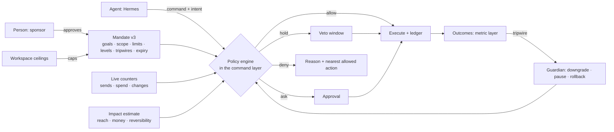

# Agentic autonomy: agents that run marketing loops within borders

Status: **design proposal** (2026-10-30), for review with the owner. The decision record is [ADR-0016](adr/0016-agent-autonomy-model.md) (Proposed); the phased plan is [wave 4](roadmap-wave-4.md).

Today an agent can do almost anything a marketer can through MCP or REST, but autonomy is one switch: the workspace approval policy (`none`, `agent_changes`, `all_publishes`) decides whether an agent's publish waits for a person. That gives two useful settings: "agents draft, people approve every change", or "agents can publish anything their scopes allow". Neither is what the product is for.

The goal of this design is a third option that can go all the way: **an agent runs a complete marketing loop (plan, build, send, measure, learn, repeat) without a person in each step, inside borders a person set, with the platform enforcing the borders, watching the results and stepping in by itself when something goes wrong.** Proposing and approving stays available, and stays the default; autonomy is earned and granted per agent, per kind of action and per audience, and it lapses unless renewed.

This page covers the model and the mechanisms. It does not fix the build order; the [roadmap](roadmap-wave-4.md) does.

## 1. Principles

1. **The platform enforces the borders, not the agent.** An agent's prompt, skill or good intentions are not a control. Every border is checked in the command layer, the one place REST, MCP, the copilot and in-platform runtimes all pass through ([ADR-0005](adr/0005-command-registry-mcp.md)). An agent that ignores its instructions hits the same wall as one that follows them.
2. **Autonomy is a grant to a named agent, for a stated purpose, with an end date.** Not a property of a token, a role or a workspace. The grant (a *mandate*) is a versioned, reviewed artifact like any other.
3. **Borders are measured in consequences, not in commands.** "May publish broadcasts" is not a border. "May send up to 5,000 messages a week to the Newsletter segment, on the newsletter topic, with unsubscribes under 0.5%" is.
4. **Irreversible actions get stricter treatment than reversible ones.** A sent e-mail cannot be unsent; a published template can be rolled back. The impact model knows the difference.
5. **Every autonomous action is explained, recorded and attributable.** The agent states what it does and why; the platform records it, links it to the mandate that allowed it, and later to what it achieved.
6. **The platform watches outcomes and pulls the brake itself.** Guardrail metrics and anomaly checks downgrade an agent to "propose only" or pause it without waiting for a person to notice.
7. **People keep the last word and an instant stop.** A person can pause one agent, all agents, or one kind of action, from the UI or a single command, and every hold, veto and pause wins over any mandate.
8. **Workspace ceilings no mandate can exceed.** An owner sets hard limits for the workspace; a mandate can only narrow them.
9. **External agents first, hosted agents too.** Hermes, Claude and other MCP clients stay the main runtime. The platform also runs loops itself for self-hosters without an agent runtime, under exactly the same borders.

## 2. What exists today

An inventory of what an agent is subject to at 0.2.10. **Shipped** means enforced in code; the rest is either missing or only described in the docs.

| Control | State | Where |
|---|---|---|
| Roles (owner, admin, marketer, approver, viewer) and 13 permissions | Shipped | `packages/commands/src/principal.ts` |
| Agent permissions = the person's role ∩ granted OAuth scopes; consent screen; scope step-up (`insufficient_scope`) | Shipped | `packages/auth`, `agents-and-mcp.md` |
| API tokens: narrow at once, widen with the password, revoke | Shipped | `apiTokens.*` |
| 59 people-only commands (approve, members, secrets, …) | Shipped | `humansOnly` in the registry |
| Drafts, versions, diffs; approval policy `none` / `agent_changes` / `all_publishes` | Shipped | `packages/artifacts` |
| Approval bundles (one review for several artifacts); agents proposing workspace settings | Shipped (0.2.6) | `artifacts.requestPublishBundle`, `workspace.proposeUpdate` |
| Send gateway: lawful basis, consent, objections, suppression, topics | Shipped | [ADR-0007](adr/0007-send-gateway-consent.md) |
| Delivery policy: frequency caps per person, quiet hours, auto-pause on bounce/complaint rates | Shipped | `delivery_policy` artifact |
| AI budgets per provider (monthly, with reservations), redaction, decision log with sampled reviews | Shipped | `packages/ai` |
| PII visibility: `profiles:pii` scope and `agentVisible` traits | Shipped | tracking plan, `packages/ai/src/context.ts` |
| Hash-chained audit log, `audit.verify` | Shipped | `audit.*` |
| Unknown input keys recorded (`system.inputWarnings`), `STRICT_INPUTS` | Shipped | #207 decides the default |
| Holdouts, metric layer, threshold alerts | Shipped (0.2.9) | `analytics.*`, `alerts.*` |
| **Audience-size threshold** for agent sends ("1,000 recipients") | **Not built**: described in `agents-and-mcp.md` §3 | — |
| **Per-agent rate limits and daily budgets** (commands, sends, LLM tokens) | **Not built**: described as "configurable" | — |
| **Kill switch per agent principal** (pause an agent and its pending drafts) | **Not built**: only token revoke and member removal | — |
| A list of connected agents with their activity | Partial: tokens are listed; OAuth-connected agents are not a first-class object | — |
| Autonomy modes per kind of action (#91) | Not built | — |
| A record of an agent's intent and rationale | Not built (approvals carry a note) | — |
| Undo for agent actions | Not built (versions exist, so republishing the previous one is possible by hand) | — |

The three "not built" rows are claimed in the architecture docs. Until Phase 17 builds them, `agents-and-mcp.md` marks them as planned.

## 3. The model

### 3.1 Agents as first-class principals

An **agent** becomes an object of its own: a name, a description, a **sponsor** (the person accountable for it, who must hold the permissions it uses), its credentials (one or more OAuth clients or API tokens, or the hosted runtime), its current mandate, and a status: `active`, `paused`, `revoked`. Today an agent is "whatever holds this token"; after this change, a token belongs to an agent, and pausing the agent stops every credential it holds at once.

The person-agent link stays: an agent never exceeds its sponsor's role (as today), and removing the sponsor pauses the agent until someone else sponsors it.

### 3.2 Action classes

Commands are grouped into **action classes** by what they change in the world, not by name. Every command declares one (the registry already has `effect`; the class is a finer label):

| Class | Examples | Reversible? |
|---|---|---|
| `read` | `analytics.query`, `profiles.get`, `segments.preview` | – |
| `draft` | `artifacts.create`, `artifacts.updateDraft` | yes (never live) |
| `content.publish` | publish a template, block, form, hosted page | yes (republish previous version) |
| `audience.publish` | publish or change a segment, static audience, audience sync | mostly (memberships recompute) |
| `send.broadcast` | publish a broadcast with a send time | **no** once sent; yes before |
| `send.direct` | `messages.sendEmail`, test sends to real people | no |
| `journey.live` | publish a journey version, enroll, migrate, pause | partly (pause yes, messages sent no) |
| `experience.live` | publish a web experience, change traffic allocation | yes |
| `spend` | ad audience syncs and conversions; budgets (later) | no (money) |
| `data.write` | `profiles.update`, imports, consent recording | partly |
| `settings` | workspace, delivery policy, purposes, brand, providers | yes, but wide blast radius |
| `destructive` | erase, delete, revoke | **no** |

`destructive`, `settings` changes to consent/purposes/delivery caps, and anything touching credentials **never run autonomously**: they always ask, whatever the mandate says. That is a fixed rule, not a default.

### 3.3 Autonomy levels

Each action class gets a level in the mandate:

| Level | Name | What happens | Typical use |
|---|---|---|---|
| L0 | **Observe** | Read only | Reporting agents, routines |
| L1 | **Propose** | Drafts and bundles; a person approves each publish | Today's `agent_changes`; the default for every class |
| L2 | **Act with veto** | The action is queued and announced; it runs after a hold window (e.g. 2 h before a broadcast) unless a person vetoes. Optionally a second, independent model checks the diff against the stated intent and the mandate first (#91) | New autonomy, building trust |
| L3 | **Act within limits** | Runs at once if within limits; reported in the digest | Routine sends to known audiences, content tweaks |
| L4 | **Run the loop** | L3 plus the agent may create new artifacts of the class and start new experiments within its goals, without a separate grant for each | A newsletter or lifecycle agent running its programme |

Anything outside the limits of its level drops one level: an L3 send that is too large becomes an L2 hold or an L1 proposal (configurable per class), with the reason. **Nothing outside the mandate's scope is ever executed**; it can only be proposed.

### 3.4 The mandate

A **mandate** is a new artifact type (`agent_mandate`), versioned and approved like a journey. Agents cannot create or change their own mandate (people-only). It holds:

- **Purpose and goals**: what the agent is for, and the measures it is judged on (from the metric layer: e.g. `campaign.conversion_rate`, `email.click_rate`, net subscriber growth), with targets.
- **Scope**: which segments and audiences it may address, which purposes and topics, which channels, which artifacts it may change (by type, by tag, by campaign, or specific ids), which brands (once multi-brand lands, #184).
- **Levels**: one level per action class.
- **Limits**: per send (recipients), per day and week (sends, messages, distinct people reached, changes, new artifacts), per person (messages from this agent per week, on top of the workspace frequency caps), spend, LLM tokens. Limits are counters the platform keeps, not numbers the agent reports.
- **Guardrails (tripwires)**: metric thresholds that stop or downgrade the agent: unsubscribe rate, complaint rate, bounce rate, a goal metric falling below its holdout, spend pacing.
- **Learning rules**: e.g. "new journeys and broadcast variants keep a 10% holdout", "a change to a live journey goes to 20% of entrants first".
- **Time**: valid from–until (default 30 days), working hours for irreversible actions, blackout dates.
- **Escalation**: who is told about holds, downgrades and digests, and through which channel (in-app, e-mail, webhook).

A mandate expires. Renewal is a person's decision, shown with the agent's record for the period: actions taken, holds vetoed, tripwires hit, goal results against holdout. That is the "review of granted autonomy" from the wave-3 plan.

### 3.5 Workspace ceilings

The owner sets **ceilings** in the workspace settings: maximum level per action class for any agent, maximum recipients per autonomous send, maximum autonomous messages per week, spend ceiling, whether L4 is allowed at all, and a workspace-wide **autonomy switch** (on / propose-only / off). A mandate is validated against the ceilings when it is approved, and the policy engine applies the lower of the two at run time, so lowering a ceiling takes effect at once for every agent.

## 4. Enforcement

### 4.1 The policy engine

One function in the command executor decides every agent write: `decide(principal, command, input) → allow | hold | ask | deny`, with reasons. It runs after permission checks and input validation, before the handler. Inputs:

- the agent, its status and current mandate version;
- the workspace ceilings and autonomy switch;
- the command's action class;
- an **impact estimate** for the call (below);
- live **counters** for the agent and the workspace (sends, messages, people, changes, spend in the current day/week), kept in Postgres with a short-lived cache in Valkey, updated in the same transaction as the action;
- open tripwires for the agent.

The decision and its reasons are part of the response, so an agent learns the border instead of guessing it. A read-only twin, `policy.check`, answers "would this be allowed, and if not, what would be?" without doing it, so agents plan inside their limits (e.g. "send to 4,800 instead of 6,200, or split over two days").

People's own actions are not affected: the engine only decides for agent principals (and for hosted runs, which are agents).

### 4.2 Impact estimates

For every class that reaches people or money, the engine computes the impact before allowing it:

- **sends**: recipient count after consent, suppression, topics and frequency caps (the broadcast preview already computes this), new versus recently-messaged people, purposes and channels;
- **journeys**: people currently waiting in the version being changed, expected entrants per day (from the trigger's recent rate), steps that send;
- **segments**: how many people enter or leave, and which live journeys and broadcasts use the segment;
- **experiences**: traffic share and pages;
- **spend**: amount and pacing against the budget.

The estimate is stored with the action, so the record shows what the agent was allowed to do and what actually happened.

### 4.3 Holds, vetoes and approvals

An L2 action becomes a **hold**: a scheduled execution with a deadline, shown in the approvals inbox with the agent's intent, the diff, the impact and a countdown. A person can veto, approve early or change the deadline. A hold's action is re-checked when it runs (the counters and tripwires may have changed). Holds reuse the approval and bundle machinery from Phases 13 and 16.

### 4.4 Intent records

Every agent write above `draft` carries an **intent**: what it is doing, why, which goal it serves, and the expected effect (e.g. "Send issue 42 to Newsletter (4,812 people). Last four issues averaged 41% opens; expect similar."). The executor requires it for L2–L4 actions and stores it in the ledger; it is shown on holds, approvals and the activity feed. A missing or empty intent is a `deny` with a clear message.

### 4.5 The independent check (optional)

For L2 and above, a mandate can require a **second model** to review the call before it runs: given the intent, the diff, the impact and the mandate text, does the action match? A mismatch drops the action to L1. This uses the existing AI runtime and budgets, is logged with the action, and is off by default (it costs tokens and adds latency). It is a defence against a confused or manipulated agent, not a replacement for the hard limits.

## 5. Safety net

### 5.1 Tripwires and the guardian

A **guardian** worker evaluates each active mandate's guardrails on the metric layer (reusing the alert evaluator from Phase 16) and on the ledger. When one trips:

- the agent drops to L1 for the affected classes (or is paused, as configured);
- queued holds are suspended;
- the sponsor is told, with the evidence;
- the episode is recorded and shown at renewal.

Examples: the unsubscribe rate of the agent's sends in the last 7 days passes 0.5%; complaints pass 0.1%; a broadcast's recipients exceed 3× the agent's median; more changes in an hour than its daily limit; its goal metric is significantly worse than holdout.

### 5.2 Anomaly checks

Besides the configured guardrails, the guardian compares an agent's behaviour with its own history: send size, send frequency, number of changes, new artifact types, error rate, denied calls in a row (an agent repeatedly probing its borders). A large deviation is a soft tripwire: it holds the next irreversible action for a person.

### 5.3 Staged rollout

Irreversible actions to large audiences go out in stages when the mandate asks for it: a **canary** share first (e.g. 10%, reusing the sampling of subject tests), a check after a wait (bounces, complaints, unsubscribes, early clicks), then the rest, or a stop. Live journey changes can go to a share of new entrants first. This is where progressive rollout (#102) re-enters the plan, scoped to agent actions.

### 5.4 Undo

Where an action can be undone, the ledger stores how: republish the previous version, cancel a scheduled broadcast, stop the rest of a staged send, pause a journey and move participants back, restore a segment version, end an experience. `agents.undo` (people, and the guardian) runs it. Sends that already happened cannot be undone; the ledger says so plainly.

### 5.5 Stop controls

- **Pause an agent**: every credential stops, holds are suspended, scheduled actions it created are held; resumable.
- **Autonomy switch** for the workspace: on, propose-only, off. Propose-only turns every level above L1 into L1 at once.
- **Pause a class**: e.g. no autonomous sends this week, everything else as before.
- All are single commands (`agents.pause`, `workspace.setAutonomy`), on the UI's top bar, and available to the guardian.

### 5.6 Shadow mode

A new or widened mandate can start in **shadow mode**: the agent runs its loop for real, but actions at L2+ are recorded as "would have done" instead of executing, and compared with what people did or approved in the same period. Shadow results are part of the case for granting the level for real.

## 6. Closing the loop

Autonomy is only useful if the agent sees what its actions did.

- **Goals** live in the mandate and in campaigns; both point at measures in the metric layer.
- **Outcome attribution**: the ledger links each action to the artifacts and campaign it touched, so `agents.report` can show "the agent sent 8 issues; opens 41% (holdout n/a), clicks 6.2%, unsubscribes 0.21%; journey variant B beat A by +1.8 pts conversion (95% CI 0.4–3.2)".
- **Learnings**: a small, inspectable store of conclusions with their evidence ("subject lines with a number win for this audience: 3 of 4 tests, +2.1 pts"), written by agents or people, read by agents through MCP resources. Not a memory dump: each learning has a source experiment and can be retracted. It is the platform's share of #85; conversational memory stays with the external agents.
- **Events for agents**: agents subscribe to what matters to them (a hold vetoed, an approval decided, a tripwire, an experiment reaching significance, an alert, a scheduled moment) through webhooks today and MCP notifications where clients support them, so a loop can react instead of polling.
- **Business context** (#85, narrow part): a versioned `business_context` artifact (offer, audience, voice, claims to avoid, legal lines) every agent reads as an MCP resource.

## 7. Where agents run

| Runtime | Who | Borders |
|---|---|---|
| **External MCP agents** (Hermes, Claude, n8n, IDEs) | Main path | Mandate via its credentials; the platform cannot see its reasoning, only its calls and intents |
| **The in-app copilot** | People working interactively | The person's own permissions; actions taken for a person in a conversation count as theirs unless the conversation is attached to an agent |
| **Hosted agent runs** (new) | Self-hosters without an agent runtime; scheduled and event-driven loops | A hosted agent is an agent with a mandate like any other; its runs are scheduled or triggered, have budgets and a run history (#86) |

Hosted runs use the copilot's MCP-in-process client and the existing AI providers and budgets. A run is a fresh session with the mandate, the business context, the relevant learnings and a bounded summary of its previous runs.

## 8. Agent programmes (what the loops are for)

These are the loops the product should be able to run, each a set of mandate templates, skills and recipes rather than hard-coded features:

1. **Newsletter editor**: weekly issue from the topic backlog and content sources (#140, #141), built from blocks, subject test, send within the mandate, report and learn. The pilot's first autonomous loop.
2. **Lifecycle optimiser**: watches journey funnels, proposes and (at L3+) ships a variant to a share of entrants with a holdout, promotes the winner, retires the loser.
3. **Campaign agent** (#64): goal and brief → campaign bundle (segment, content, journey or broadcasts, holdout) → run → evaluate against the goal.
4. **Experimentation agent**: web experiences: proposes variants, allocates traffic, stops on sequential or Bayesian results, promotes.
5. **Audience curator**: keeps segments healthy (stale members, overlaps, growth), suggests exclusions, manages sunset policies for inactive subscribers.
6. **Deliverability guardian**: watches bounces, complaints and provider signals; throttles or pauses streams; low risk, high value, a natural first L3.
7. **Paid media agent** (later): ad audiences and conversions, then budgets within a spend mandate.
8. **Decision models in journeys** (#192–#194): scope-B agents that decide per person inside a journey step, under the same budgets and logs as `aiDecide`.

## 9. Threats and how the design answers them

| Threat | Answer |
|---|---|
| A confused agent sends the wrong thing to the wrong people | Scope and per-send limits, impact estimate, L2 hold, canary stage, tripwires |
| A manipulated agent (prompt injection through content sources, inbound replies, web pages, profile traits) | Borders are enforced outside the agent; content from outside is marked untrusted in MCP resources; the independent check; agents cannot widen their own scopes or mandates |
| An agent probing its limits | Denials are counted; repeated denials are an anomaly that pauses irreversible actions |
| Several agents together exceed what one may | Workspace ceilings and workspace-level counters across agents; per-person contact pressure across agents (the delivery policy's frequency caps already apply to every sender) |
| Slow drift: each action fine, the trend bad | Guardrails on rolling windows; goal versus holdout; renewal review |
| A runaway loop (an agent reacting to its own events) | Rate limits on changes, loop detection on the ledger (same artifact changed back and forth) |
| Leaking personal data through agents | Existing `agentVisible` and `profiles:pii`; mandates can drop PII scopes; outputs of hosted runs are redacted as AI calls are today |
| Credential theft | An agent's credentials are bounded by its mandate; pausing the agent revokes all of them; anomaly checks |
| Accountability gaps | Sponsor per agent, intent per action, hash-chained audit, ledger with mandate version |

## 10. Compatibility

- The approval policy stays and keeps its meaning for agents without a mandate: `agent_changes` is equivalent to every class at L1. Existing tokens and OAuth clients keep working; on upgrade each becomes an agent with no mandate (L1 everywhere, as today).
- REST and MCP stay backwards compatible: new commands, new response fields (`decision`, `reasons`), and a new required field (`intent`) only for L2+ actions, which no existing agent has.
- The pilot's wave-3 decision (Hermes sends the weekly broadcast to the subscriber segment within a recipient cap) becomes the first mandate.

## 11. Open questions for the owner

1. **Default level ceiling** for a new workspace: L1 (safest, today's behaviour) or L2 (veto windows on by default)?
2. **L4 at all** in the first releases, or only L0–L3 until the safety net (Phase 19) has run on the pilot for a while?
3. **The independent check**: build it in Phase 18 (cheap with the existing AI runtime) or only on demand?
4. **Hosted agents**: in this wave (Phase 21) or parked until a self-hoster without a runtime asks?
5. **Spend autonomy** (ad budgets): in scope for this wave, or parked behind an e-commerce or paid-media pilot?
6. **Multi-brand** (#184) before or after the autonomy phases? Agents across brands (#187) need it; the pilot does not yet.
