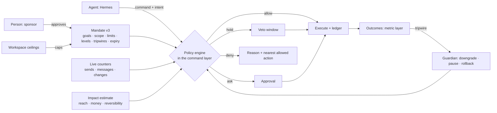

# Agentic autonomy: agents that run marketing loops within borders

Status: **accepted design** (2026-10-30; owner decisions in §11), **built through Phase 20** (0.3.0–0.6.0, fixes through 0.6.1). Phases 21–22 remain planned. The decision record is [ADR-0016](adr/0016-agent-autonomy-model.md); the phased plan is [wave 4](roadmap-wave-4.md).

Before wave 4 (0.2.10) an agent could do almost anything a marketer could through MCP or REST, but autonomy was one switch: the workspace approval policy (`none`, `agent_changes`, `all_publishes`) decided whether an agent's publish waited for a person. That gave two useful settings: "agents draft, people approve every change", or "agents can publish anything their scopes allow". Neither was what the product is for.

The goal of this design was a third option that can go all the way: **an agent runs a complete marketing loop (plan, build, send, measure, learn, repeat) without a person in each step, inside borders a person set, with the platform enforcing the borders, watching the results and stepping in by itself when something goes wrong.** Proposing and approving stays available, and stays the default; autonomy is earned and granted per agent, per kind of action and per audience, and it lapses unless renewed. That is what Phases 17–20 built and what the table in §2 records.

This page covers the model and the mechanisms. It does not fix the build order; the [roadmap](roadmap-wave-4.md) does.

## 1. Principles

1. **The platform enforces the borders, not the agent.** An agent's prompt, skill or good intentions are not a control. Every border is checked in the command layer, the one place REST, MCP, the copilot and in-platform runtimes all pass through ([ADR-0005](adr/0005-command-registry-mcp.md)). An agent that ignores its instructions hits the same wall as one that follows them.
2. **Autonomy is a grant to a named agent, for a stated purpose, with an end date.** Not a property of a token, a role or a workspace. The grant (a *mandate*) is a versioned, reviewed artifact like any other.
3. **Borders are measured in consequences, not in commands.** "May publish broadcasts" is not a border. "May send up to 5,000 messages a week to the Newsletter segment, on the newsletter topic, with unsubscribes under 0.5%" is.
4. **Irreversible actions get stricter treatment than reversible ones.** A sent e-mail cannot be unsent; a published template can be rolled back. The impact model knows the difference.
5. **Every autonomous action is explained, recorded and attributable.** The agent states what it does and why; the platform records it, links it to the mandate that allowed it, and later to what it achieved.
6. **The platform watches outcomes and pulls the brake itself.** Guardrail metrics and anomaly checks downgrade an agent to "propose only" or pause it without waiting for a person to notice.
7. **People keep the last word and an instant stop.** A person can pause one agent, all agents, or one kind of action, from the UI or a single command, and every hold, veto and pause wins over any mandate.
8. **Workspace ceilings no mandate can exceed.** An owner sets hard limits for the workspace; a mandate can only narrow them.
9. **External agents first, hosted agents too.** Hermes, Claude and other MCP clients stay the main runtime. The platform also runs loops itself for self-hosters without an agent runtime, under exactly the same borders.

## 2. What exists today (0.6.1)

An inventory of what an agent is subject to at 0.6.1. **Shipped** means enforced in code; a release says when it became true.

| Control | State | Where |
|---|---|---|
| Roles (owner, admin, marketer, approver, viewer) and 13 permissions | Shipped | `packages/commands/src/principal.ts` |
| Agent permissions = the person's role ∩ granted OAuth scopes; consent screen; scope step-up (`insufficient_scope`) | Shipped | `packages/auth`, `agents-and-mcp.md` |
| API tokens: narrow at once, widen with the password, revoke | Shipped | `apiTokens.*` |
| **Agents as first-class principals**: name, sponsor, status, credentials; list, get, update, pause, resume and revoke | Shipped (0.3.0) | `packages/auth/src/agents.ts`, Settings → Agents |
| People-only commands (approve, members, secrets, mandates, …) | Shipped | `humansOnly` in the registry |
| Drafts, versions, diffs; approval policy `none` / `agent_changes` / `all_publishes` | Shipped | `packages/artifacts` |
| Approval bundles (one review for several artifacts); agents proposing workspace settings | Shipped (0.2.6) | `artifacts.requestPublishBundle`, `workspace.proposeUpdate` |
| Send gateway: lawful basis, consent, objections, suppression, topics | Shipped | [ADR-0007](adr/0007-send-gateway-consent.md) |
| Delivery policy: frequency caps per person, quiet hours, auto-pause on bounce/complaint rates | Shipped | `delivery_policy` artifact |
| AI budgets per provider (monthly, with reservations), redaction, decision log with sampled reviews | Shipped | `packages/ai` |
| PII visibility: `profiles:pii` scope and `agentVisible` traits | Shipped | tracking plan, `packages/ai/src/context.ts` |
| Hash-chained audit log, `audit.verify` | Shipped | `audit.*` |
| Unknown input keys recorded (`system.inputWarnings`), `STRICT_INPUTS` | Partial: opt-in, the default still warns (#207 open) | `packages/commands/src/unknownKeys.ts` |
| Holdouts, metric layer, threshold alerts | Shipped (0.2.9) | `analytics.*`, `alerts.*` |
| Action classes on every command and impact estimates | Shipped (0.3.0) | `packages/commands/src/policy.ts` |
| Workspace ceilings and the autonomy switch (on / propose-only / off; L1 default; `allowLoops`) | Shipped (0.3.0) | `workspace.autonomy`, `workspace.setAutonomy` |
| **Audience-size threshold** for agent actions (default 1,000) | Shipped (0.3.0) | `workspace.autonomy` |
| **Per-agent 24-hour limits** (500 changes, 1,000 messages) | Shipped (0.3.0) | `workspace.autonomy` |
| **Kill switch** per agent (pause every credential, hold its pending approvals), resume and revoke | Shipped (0.3.0) | `agents.pause`, `agents.resume`, `agents.revoke` |
| Agent list with what each did, its credentials and stop controls | Shipped (0.3.0) | `agents.list`, `agents.activity`, Settings → Agents |
| **Mandates** with a level per action class (L0–L3), scope, limits, guardrails, working hours, expiry | Shipped (0.4.0) | `agent_mandate` artifact, `packages/artifacts/src/mandates.ts` |
| **Holds** with a veto window, approve early or veto | Shipped (0.4.0) | approvals inbox, `agents.activity` |
| **Intent records** on L2+ actions | Shipped (0.4.0) | action ledger |
| Notifications and daily digests to sponsors and escalation people | Shipped (0.4.0) | `apps/server/src/agents/notifications.ts` |
| Business context as an MCP resource | Shipped (0.4.0) | `business_context`, `business-context://current` |
| **Independent check** by a second model, per mandate | Shipped (0.4.0) | `apps/server/src/agents` (AI call kind `check`) |
| **Guardian** (guardrails, anomalies, probing, loops; cap or pause; episodes) | Shipped (0.5.0) | `apps/server/src/agents/guardian.ts`, `agents.guardian`, `agents.clearGuard` |
| **Staged sends** (canary, wait, check, rest or stop) | Shipped (0.5.0) | broadcast stages, `broadcasts.status`, `broadcasts.continue` |
| **Undo** of reversible agent actions | Shipped (0.5.0, hardened through 0.6.0) | `agents.undo`, `agents.activity` |
| **Shadow mode** and the shadow report | Shipped (0.5.0) | `agents.shadowReport` |
| **Learning rules** (required holdouts on journeys, broadcasts, experiences) | Shipped (0.5.0) | mandate `learning` |
| **Thin hosted agents** (schedules, run history, per-run token and tool-call budgets) | Shipped (0.5.0) | `agents.createHosted`, `agents.hostedRuns`, Settings → Agents |
| **Level 4** (run the loop), earned per agent and class | Shipped (0.6.0; earning tightened in 0.6.1) | mandate `levels`, `workspace.autonomy` |
| **Agent reports** (`agents.report`, last 30 days in the UI) | Shipped (0.6.0, fixed in 0.6.1) | `packages/auth/src/agents.ts` |
| **Learnings** store with evidence, MCP resource, people-only retraction | Shipped (0.6.0) | `learnings.*`, `learnings://current` |
| **Events for agents** (webhooks and `agents.events` polling) | Shipped (0.6.0) | `agents.subscribe`, `agents.events` |
| **Programmes** as mandate templates, hosted-agent templates and recipes (newsletter, lifecycle, campaign, experimentation, audience curator, deliverability guardian) | Shipped (0.6.0) | [docs/agents.md](../agents.md), [recipes.md](../recipes.md) |
| **Bulk enrollment** by segment | Shipped (0.6.0; journey and segment versions pinned in 0.6.1) | `journeys.enrollSegment` |
| `policy.check` (the read-only twin of a policy decision) | **Not built in 0.6.1** | The decision and its reasons come back with the action; there is no preview command |

### The 0.2.10 baseline (history)

The first version of this inventory, written during the design, marked the audience threshold, per-agent limits, the agent list and kill switch, autonomy modes, intent records and undo as **not built**. That was accurate at 0.2.10. They shipped in 0.3.0 (threshold, limits, agent list, pause), 0.4.0 (levels, mandates, intents) and 0.5.0 (undo). The table above is the current state; `docs/agents.md` is the operator's guide.

## 3. The model

### 3.1 Agents as first-class principals

An **agent** is an object of its own: a name, a description, a **sponsor** (the person accountable for it, who must hold the permissions it uses), its credentials (one or more OAuth clients or API tokens, the hosted runtime or an event subscription), its current mandate, and a status: `active`, `paused`, `revoked`. This shipped in 0.3.0. Before it, an agent was "whatever held this token"; since then, a token belongs to an agent, and pausing the agent stops every credential it holds at once.

The person-agent link stays: an agent never exceeds its sponsor's role (as today), and removing the sponsor pauses the agent until someone else sponsors it.

### 3.2 Action classes

Commands are grouped into **action classes** by what they change in the world, not by name. Every command an agent may run declares one; people-only commands fall back to their `effect` (read, destructive or settings), and a registry test catches a write without a class:

| Class | Examples | Reversible? |
|---|---|---|
| `read` | `analytics.query`, `profiles.get`, `segments.preview` | – |
| `draft` | `artifacts.create`, `artifacts.updateDraft` | yes (never live) |
| `content.publish` | publish a template, block, form, hosted page | yes (republish previous version) |
| `audience.publish` | publish or change a segment, static audience, audience sync | mostly (memberships recompute) |
| `send.broadcast` | publish a broadcast with a send time | **no** once sent; yes before |
| `send.direct` | `messages.sendEmail`, test sends to real people | no |
| `journey.live` | publish a journey version, enroll, migrate | partly (messages sent no) |
| `experience.live` | publish a web experience, change traffic allocation | yes |
| `spend` | ad audience syncs and conversions; budgets (later) | no (money) |
| `data.write` | `profiles.update`, imports, consent recording | partly |
| `settings` | workspace, delivery policy, purposes, brand, providers | yes, but wide blast radius |
| `destructive` | erase, delete, revoke | **no** |

`destructive`, `settings` changes to consent/purposes/delivery caps, and anything touching credentials **never run autonomously**: they always ask, whatever the mandate says. That is a fixed rule, not a default.

### 3.3 Autonomy levels

Each action class gets a level in the mandate:

| Level | Name | What happens | Typical use |
|---|---|---|---|
| L0 | **Observe** | Read only | Reporting agents, routines |
| L1 | **Propose** | Drafts and bundles; a person approves each publish | The `agent_changes` policy; the default for every class |
| L2 | **Act with veto** | The action is queued and announced; it runs after a hold window (e.g. 2 h before a broadcast) unless a person vetoes. Optionally a second, independent model checks the diff against the stated intent and the mandate first (#91) | New autonomy, building trust |
| L3 | **Act within limits** | Runs at once if within limits; reported in the digest | Routine sends to known audiences, content tweaks |
| L4 | **Run the loop** | L3 plus the agent may create new artifacts of the class and start new experiments within its goals, without a separate grant for each. **Earned:** a mandate can grant L4 for a class only after the agent has run it at L3 for at least 28 days without a guardian episode, or after a shadow-mode run of the same length (§5.6) | A newsletter or lifecycle agent running its programme |

Anything outside the limits of its level drops one level: an L3 send that is too large becomes an L2 hold or an L1 proposal (configurable per class), with the reason. **Nothing outside the mandate's scope is ever executed**; it can only be proposed.

L0–L3 shipped in 0.4.0. L4 shipped in 0.6.0 and is earned from level-3 operation; since 0.6.1 only ledger entries the engine decided at level 3 or above count, so a held change that ran after its window does not.

### 3.4 The mandate

A **mandate** is a versioned artifact type (`agent_mandate`), approved like a journey (built in 0.4.0). Agents cannot create or change their own mandate (people-only). It holds:

- **Purpose and goals**: what the agent is for, and the measures it is judged on (from the metric layer: e.g. `campaign.conversion_rate`, `email.click_rate`, net subscriber growth), with targets.
- **Scope**: which segments and audiences it may address, which purposes and topics, which channels, which artifacts it may change (by type or by specific ids), and a **brand** field (optional, defaulting to the whole workspace) that is reserved from the start and becomes meaningful when multi-brand lands (#184).
- **Levels**: one level per action class.
- **Limits**: per send (recipients), per day (sends, changes, messages) and recipient growth over the previous send. Limits are counters the platform keeps, not numbers the agent reports. The design also anticipated per-person weekly and spend/token limits; 0.6.1 does not implement those, and hosted runs carry their own per-run token and tool-call budgets.
- **Guardrails (tripwires)**: metric thresholds on the agent's own sends that cap or pause it: unsubscribe rate, complaint rate, bounce rate over a window. (The design also anticipated a goal metric falling below its holdout and spend pacing; 0.6.1 does not implement those as guardian guardrails.)
- **Learning rules**: e.g. "journeys keep a 10% control group", "broadcasts have a holdout or subject test", "experiences hold out 10%".
- **Time**: valid until a date (30 days is the recommended default, at most a year), working hours for irreversible actions, blackout dates.
- **Escalation**: who is told about holds, refusals and guardrail hits, by e-mail, besides the sponsor.

A mandate expires. Renewal is a person's decision, shown with the agent's record for the period: actions taken, holds vetoed, tripwires hit, goal results against holdout. That is the "review of granted autonomy" from the wave-3 plan.

### 3.5 Workspace ceilings

**The default is a person.** A new workspace's ceiling is L1 for every class, so nothing changes on upgrade and every agent proposes. Granting autonomy is a decision, but an easy one: Settings → Agents → Autonomy (`workspace.setAutonomy`) has one switch per ceiling. The design intended the setup flow (`am init`, the first sign-in) to ask whether to allow L2; 0.6.1 does not ask, and the settings are the only place.

The owner sets **ceilings** in the workspace settings: maximum level per action class for any agent, an audience threshold, per-agent limits per 24 hours, whether L4 is allowed at all, and a workspace-wide **autonomy switch** (on / propose-only / off). A mandate is validated against the ceilings when it is approved, and the policy engine applies the lower of the two at run time, so lowering a ceiling takes effect at once for every agent.

## 4. Enforcement

### 4.1 The policy engine

One function in the command executor decides every agent write: `decide(principal, command, input) → allow | hold | ask | deny`, with reasons. It runs after permission checks and input validation, before the handler. Inputs:

- the agent, its status and current mandate version;
- the workspace ceilings and autonomy switch;
- the command's action class;
- an **impact estimate** for the call (below);
- live **counters** for the agent (changes, messages, sends and the previous send's reach), read from the action ledger in Postgres and updated in the same transaction as the action;
- open tripwires for the agent.

The decision and its reasons are part of the response, so an agent learns the border instead of guessing it. The design also described a read-only twin, `policy.check`, that would answer "would this be allowed, and if not, what would be?" without doing it, so agents could plan inside their limits (e.g. "send to 4,800 instead of 6,200, or split over two days"). **It is not implemented in 0.6.1**; an agent gets the same reasons only when it attempts the action.

People's own actions are not affected: the engine only decides for agent principals (and for hosted runs, which are agents).

### 4.2 Impact estimates

For the classes that reach people, the engine computes the impact before allowing it:

- **sends**: recipient count after consent, suppression, topics and frequency caps (the broadcast preview already computes this), new versus recently-messaged people, purposes and channels;
- **journeys**: people currently waiting in the version being changed, expected entrants per day (from the trigger's recent rate), steps that send;
- **segments**: how many people enter or leave, and which live journeys and broadcasts use the segment;
- **experiences**: traffic share and pages.

The design also described a spend estimate (amount and pacing against a budget); agent-managed spend is not built (#212).

The estimate is stored with the action, so the record shows what the agent was allowed to do and what actually happened.

### 4.3 Holds, vetoes and approvals

An L2 action becomes a **hold**: a scheduled execution with a deadline, shown in the approvals inbox with the agent's intent, the diff, the impact and a countdown. A person can veto, approve early or change the deadline. A hold's action is re-checked when it runs (the counters and tripwires may have changed). Holds reuse the approval and bundle machinery from Phases 13 and 16.

### 4.4 Intent records

Every agent write above `draft` records an **intent**: what it is doing, why, which goal it serves, and the expected effect (e.g. "Send issue 42 to Newsletter (4,812 people). Last four issues averaged 41% opens; expect similar."). The engine takes an explicit `intent` field or, failing that, the review note or reason the command already carries, and stores it in the ledger; it is shown on holds, approvals and the activity feed. Built in 0.4.0. A missing intent is recorded as empty; it is the independent check that uses it, not a refusal.

### 4.5 The independent check (optional)

For L2 and above, a mandate can require a **second model** to review the call before it runs: given the intent, the diff, the impact and the mandate text, does the action match? A mismatch drops the action to L1. This uses the existing AI runtime and budgets, is logged with the action, and is off by default (it costs tokens and adds latency). It shipped in 0.4.0. It is a defence against a confused or manipulated agent, not a replacement for the hard limits. It is recommended for any agent that reads content from outside the workspace (content sources (#140), inbound replies, web pages); the lifecycle and experimentation templates turn it on, but it is not automatic.

## 5. Safety net

### 5.1 Tripwires and the guardian

A **guardian** worker evaluates each active mandate's guardrails on the metric layer (reusing the alert evaluator from Phase 16) and on the ledger. When one trips:

- the agent is capped (every change waits for a person) or paused, as the check dictates;
- queued holds become ordinary approvals, so nothing it asked for runs by itself;
- the sponsor is told, with the evidence;
- the episode is recorded and shown at renewal until a person clears the cap.

Examples: the unsubscribe rate of the agent's sends in the last 7 days passes 0.5%; complaints pass 0.1%; a broadcast's recipients exceed 3× the agent's median; more changes in an hour than the burst limit; 10 refusals in an hour (probing); the same artifact changed six times in an hour (a loop). Built in 0.5.0.

### 5.2 Anomaly checks

Besides the configured guardrails, the guardian compares an agent's behaviour with its own history: send size against its median, a burst of changes, error rate, denied calls in a row (an agent repeatedly probing its borders). A large deviation caps or stops the agent; the checks are listed in [docs/agents.md §The guardian](../agents.md#the-guardian).

### 5.3 Staged rollout

A broadcast can go out in stages when its editor asks for it: a **canary** share first (e.g. 10%, reusing the sampling of subject tests), a check after a wait (bounces, complaints, unsubscribes, early clicks), then the rest, or a stop. Live journey changes are not canaried in 0.6.1. This is where progressive rollout (#102) re-enters the plan, scoped to agent actions; that part is still planned.

### 5.4 Undo

Where an action can be undone, the ledger stores how: republish the previous version (or take a first publish out of service), cancel a scheduled broadcast, stop the rest of a staged send. `agents.undo` (people only) runs it. Journeys and experiences have no pause of their own yet, so undoing their first publish stops new entrants and stops serving, while participants already in a journey keep going. Sends that already happened cannot be undone; the ledger says so plainly. Built in 0.5.0; 0.5.2–0.6.0 added the checks that refuse an undo which would discard newer work.

### 5.5 Stop controls

- **Pause an agent**: every credential stops, its pending approvals cannot be approved, and a hosted run stops at its next command; resumable.
- **Autonomy switch** for the workspace: on, propose-only, off. Propose-only turns every level above L1 into L1 at once.
- **Pause a class**: lower that class's ceiling to 1 (e.g. no autonomous sends this week) — the same `workspace.setAutonomy` call; everything else stays as before.
- All are single commands (`agents.pause`, `workspace.setAutonomy`), in Settings → Agents, and available to the guardian. A top-bar badge shows when the workspace is propose-only or off.

### 5.6 Shadow mode

A new or widened mandate can start in **shadow mode**: the agent runs its loop for real, but actions at L2+ are recorded as "would have done" instead of executing, and compared with what people did or approved in the same period. Shadow results are part of the case for granting the level for real. Built in 0.5.0 (`agents.shadowReport`).

## 6. Closing the loop

Autonomy is only useful if the agent sees what its actions did. This loop is built (0.6.0, with report fixes in 0.6.1):

- **Goals** live in the mandate and in campaigns; both point at measures in the metric layer.
- **Outcome attribution**: the ledger links each action to the artifacts and campaign it touched, so `agents.report` shows "the agent sent 8 issues; opens 41% (holdout n/a), clicks 6.2%, unsubscribes 0.21%; journey variant B beat A by +1.8 pts conversion (95% CI 0.4–3.2)".
- **Learnings**: a small, inspectable store of conclusions with their evidence ("subject lines with a number win for this audience: 3 of 4 tests, +2.1 pts"), written by agents or people, read by agents through MCP resources. Not a memory dump: each learning has a source experiment and can be retracted. It is the platform's share of #85; conversational memory stays with the external agents.
- **Events for agents**: agents subscribe to what matters to them (a hold vetoed, an approval decided, a tripwire, an experiment reaching significance, an alert, a scheduled moment) through webhooks and `agents.events` polling, so a loop can react instead of polling every tool.
- **Business context** (#85, narrow part): a versioned `business_context` artifact (offer, audience, voice, claims to avoid, legal lines) every agent reads as an MCP resource. Built in 0.4.0.

## 7. Where agents run

| Runtime | Who | Borders |
|---|---|---|
| **External MCP agents** (Hermes, Claude, n8n, IDEs) | Main path | Mandate via its credentials; the platform cannot see its reasoning, only its calls and intents |
| **The in-app copilot** | People working interactively | The person's own permissions; actions taken for a person in a conversation count as theirs. Attaching the copilot to an agent so it acts under a mandate is Phase 21 |
| **Hosted agent runs** (built 0.5.0, thin) | Self-hosters without an agent runtime; scheduled loops | A hosted agent is an agent with a mandate like any other; its runs are scheduled (`hourly`, `daily:HH:MM`, `weekly:day:HH:MM`), have per-run token and tool-call budgets, and keep a run history (#86) |

A **thin version shipped in 0.5.0**: scheduled, read-mostly runs for reports and the deliverability guardian on the copilot's runtime, with starter templates for the programmes of Phase 20. The full runtime (event triggers, the copilot attached to an agent, memory and skills) is Phase 21.

Hosted runs use the copilot's in-process MCP client and the existing AI providers and budgets. Each run is a fresh session with the agent's instructions and mandate; there is no carry-over from the previous run beyond those instructions in 0.6.1 (a bounded summary of previous runs is Phase 21).

## 8. Agent programmes (what the loops are for)

These are the loops the product can run, each a set of mandate templates, hosted-agent templates, skills and recipes rather than hard-coded features. All but the last two shipped as programmes in 0.6.0; the month-long pilot runs still have to prove them.

1. **Newsletter editor**: weekly issue from the topic backlog and content sources (#140, #141), built from blocks, subject test, send within the mandate, report and learn. The pilot's first autonomous loop. Built as a programme, hosted-agent template and recipe.
2. **Lifecycle optimiser**: watches journey funnel splits (`journeys.splitResult`), promotes the winning arm and retires the losing one by publishing a new journey version, proposes the next variant and records learnings. Built.
3. **Campaign agent** (#64): goal and brief → campaign bundle (segment, content, journey or broadcasts, holdout) → run → evaluate against the goal. Built: agents draft the brief; only people approve it, and every publish stays a person's decision at level 1.
4. **Experimentation agent**: web experiences: proposes variants, allocates traffic, stops on the experience's analysis method, promotes or removes, and records learnings. Built.
5. **Audience curator**: keeps segments healthy (stale members, overlaps, growth), suggests exclusions, manages sunset policies for inactive subscribers. Built as a programme that proposes drafts; it never deletes profiles or changes consent.
6. **Deliverability guardian**: watches bounces, complaints and provider signals and proposes a pause through the normal approval and mandate path; a person still pauses the stream. Built as a hosted-agent template.
7. **Paid media agent**: ad audiences and conversions under the normal limits; not built as a programme. No money moves: budget and bid autonomy needs its own design first (#212).
8. **Decision models in journeys** (#192–#194): scope-B agents that decide per person inside a journey step, under the same budgets and logs as `aiDecide`. Planned for Phase 21.

## 9. Threats and how the design answers them

| Threat | Answer |
|---|---|
| A confused agent sends the wrong thing to the wrong people | Scope and per-send limits, impact estimate, L2 hold, canary stage, tripwires |
| A manipulated agent (prompt injection through content sources, inbound replies, web pages, profile traits) | Borders are enforced outside the agent; content from outside is marked untrusted in MCP resources; the independent check; agents cannot widen their own scopes or mandates |
| An agent probing its limits | Denials are counted; 10 refusals in an hour pause the agent |
| Several agents together exceed what one may | Workspace ceilings cap each agent; the delivery policy's frequency caps apply to every sender. Aggregate counters across agents and contact pressure between them are not built (Phase 22) |
| Slow drift: each action fine, the trend bad | Guardrails on rolling windows; renewal review with `agents.report` against goals and holdouts |
| A runaway loop (an agent reacting to its own events) | Rate limits on changes, loop detection on the ledger (same artifact changed back and forth) |
| Leaking personal data through agents | Existing `agentVisible` and `profiles:pii`; mandates can drop PII scopes; outputs of hosted runs are redacted as AI calls are today |
| Credential theft | An agent's credentials are bounded by its mandate; pausing the agent stops all of them and revoking kills them; anomaly checks |
| Accountability gaps | Sponsor per agent, intent per action, hash-chained audit, ledger with mandate version |

## 10. Compatibility

- The approval policy stays and keeps its meaning for agents without a mandate: `agent_changes` is equivalent to every class at L1. Existing tokens and OAuth clients kept working; on upgrade each became an agent with no mandate (L1 everywhere, as before).
- REST and MCP stayed backwards compatible: new commands, new response fields (`decision`, `reasons`), and an `intent` recorded with agent actions (the explicit field, else the review note or reason).
- The pilot's wave-3 decision (Hermes sends the weekly broadcast to the subscriber segment within a recipient cap) became the first mandate template.

## 11. Decisions (owner, 2026-10-30)

1. **The default is a person; autonomy is a decision, and an easy one.** New workspaces get an L1 ceiling for every class (agents propose, as today). **Shipped in 0.3.0**; in 0.6.1 the choice is in Settings → Agents → Autonomy, not in setup.
2. **L4 is built in this wave (Phase 20), and earned per agent:** at least four weeks at L3 on that class without a tripwire, or a shadow-mode run of the same length. **Shipped in 0.6.0**, with level-3-only earning enforced from 0.6.1.
3. **The independent check is built in Phase 18**, off by default and switchable per mandate; on by default in the templates of agents that read external content. **Shipped in 0.4.0**; it is on in the lifecycle and experimentation templates, not automatically elsewhere.
4. **Hosted agents come early in a thin version** (Phases 19–20: scheduled reports and the deliverability guardian); the full runtime stays in Phase 21. **Thin version shipped in 0.5.0.**
5. **Ad audiences and conversions only.** Agents managing ad spend is wanted later, but needs its own design first (algorithmic approach, attribution, coexisting with the platforms' bidding): #212. **Still open.**
6. **Multi-brand after the autonomy phases, with the brand field reserved now:** agents and mandates have an optional brand scope that defaults to the whole workspace. **The field shipped; multi-brand (#184, #187) is open.**
