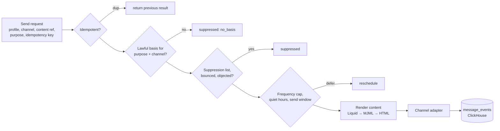

# Channels, web personalization & integrations

## 1. Send gateway

All outbound communication — email, webhooks, later SMS and push — passes through **one send gateway** ([ADR-0007](adr/0007-send-gateway-consent.md)). Journeys, campaigns, transactional API calls and agents can only *request* a send; the gateway decides.



Every decision (including "suppressed because X") is logged, so marketers and agents can answer *"why did/didn't this person get the email?"*.

## 2. Channel adapter SDK

```ts
interface ChannelAdapter<Config, Message> {
  kind: 'email' | 'webhook' | 'sms' | 'push';
  id: string;                         // 'ses', 'postmark', 'smtp', 'sendgrid', 'mailgun', ...
  configSchema: ZodType<Config>;      // rendered as settings form in UI, validated for MCP
  send(msg: Message, ctx: SendContext): Promise<SendResult>;   // must be idempotent per ctx.idempotencyKey
  parseWebhook?(req: RawRequest): ProviderEvent[];             // bounces, complaints, delivery, opens
  rateLimit?: RateLimitSpec;
  healthCheck?(): Promise<Health>;
}
```

| Channel | Phase | Adapters |
|---|---|---|
| Email | 2 | **SMTP first** (Nodemailer, MIT — also covers Mailpit for dev, Postfix, any relay), Amazon SES, Postmark, SendGrid, Mailgun, Brevo; EU-hosted providers documented |
| Webhooks | 2 | Generic HTTPS with HMAC signatures, retries with backoff, dead letter; SSRF-protected egress |
| SMS | 3 | Twilio, Vonage, MessageBird/Bird, 46elks (EU) |
| Push | 3 | FCM, APNs, Web Push (VAPID) |

SMTP relays give no delivery webhooks, so the SMTP adapter handles bounces via VERP return-paths and a bounce mailbox (IMAP polling, DSN parsing per RFC 3464) and synchronous SMTP rejections.

Email-specific features: dedicated sending domains with SPF/DKIM/DMARC setup guidance, one-click unsubscribe (RFC 8058) on every marketing email, bounce & complaint processing into suppression, open/click tracking **configurable per workspace** — default: **click tracking on, open-pixel tracking off** (pixel tracking may require consent in the EU), warm-up throttles.

## 3. Web personalization

### 3.1 Experience model

An **experience** (versioned artifact) = targeting (segment DSL + page/URL rules + session conditions) + placement (CSS selector / named slot / SDK callback) + variants (HTML/JSON content, or a component reference) + allocation (A/B/n, holdout) + goal metrics.

### 3.2 What "in-session" requires — three tiers

| Tier | Example | Latency need | How we serve it | Phase |
|---|---|---|---|---|
| **T1: next page view** | Visitor viewed 3 shoe pages → homepage hero shows shoes on next navigation | event → decision < 1 s | Ingest updates Valkey session state synchronously; next `decide` call sees it | 3 (v1) |
| **T2: same page, client-side** | Exit intent, scroll depth, time on page → show overlay | instant | Decision API returns a **decision bundle** (eligible experiences + client-side rules); SDK evaluates triggers locally | 3 (v1) |
| **T3: first paint, no flicker** | Known visitor's hero personalized before render | < 50 ms server, < 150 ms total | `decide` called early (or server-side from the site's backend/edge) with anti-flicker timeout; edge deployment later | 3 basic, edge later |

Conclusion: **in-session personalization is achievable without heavy infrastructure** as long as the ingest path writes session state to Valkey before acknowledging, and the decision API reads only from Valkey. Things that do *not* belong in the hot path: ClickHouse queries, LLM calls, Postgres joins. AI-generated variants are produced ahead of time (or asynchronously and cached), never on the request.

### 3.3 Decision API

```
POST /v1/decide
{ anonymousId, userId?, sessionId, page: { url, referrer, … }, placements: ["home_hero", "cart_upsell"], consent }
→ { decisions: [{ placement, experienceId, variantId, content, trackingToken }],
    clientRules: [...], ttl }
```

- Reads profile snapshot (traits allowed for personalization, segment memberships), session state and RT counters from Valkey; evaluates experience targeting compiled to a fast in-memory predicate; sticky variant assignment via hashing `(experience, profile)`.
- Exposures and conversions come back as events → ClickHouse → experiment analysis (frequentist + sequential testing; Bayesian later).
- Respects consent: without personalization consent, only non-personal (contextual: page, geo-country, device) targeting is allowed.

### 3.4 JS SDK (`sdk-js`)

- Small (<15 kB gz target), Segment-compatible tracking API (`track/page/identify`), consent API, `decide`/render helpers, anti-flicker snippet, SPA route detection.
- **No cookies or storage before consent** where required; cookieless mode (session-only) available.
- CMP integration: IAB TCF v2.2 signals, Google Consent Mode signals, or direct `sdk.consent.set({...})` from any CMP.
- Server-side helpers (Node, later others) for SSR personalization.

## 4. Integrations

- **Connector SDK** (TypeScript) with three kinds: *sources* (pull/receive data → events/profiles), *destinations* (push events/audiences out), *actions* (callable from journey nodes). Each connector declares config schema, auth type (API key / OAuth2), and rate limits — all auto-exposed in UI and MCP.
- **First-party connectors:** not a v1 priority. When built, **Shopify and Salesforce** first; other candidates: WooCommerce, Stripe, HubSpot, CSV/SFTP, Postgres/warehouse.
- **Long tail without building everything:**
  - Outbound/inbound webhooks + our MCP server let **n8n, Activepieces, Zapier, Make** orchestrate us (as external systems — n8n is fair-code and is not embedded).
  - **Activepieces pieces** (MIT, TypeScript, published on npm) are worth evaluating as an embeddable action library behind our connector interface — to be validated in a spike (license of individual pieces, runtime isolation).
- **OAuth for connectors** handled by our own token store (encrypted), refresh workers and per-connector scopes. (Nango was considered but is not under a permissive license.)
