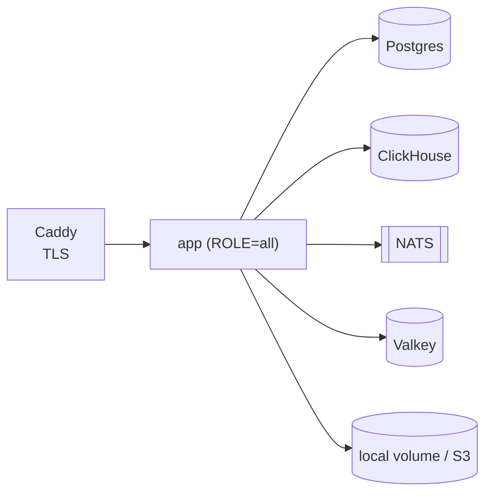
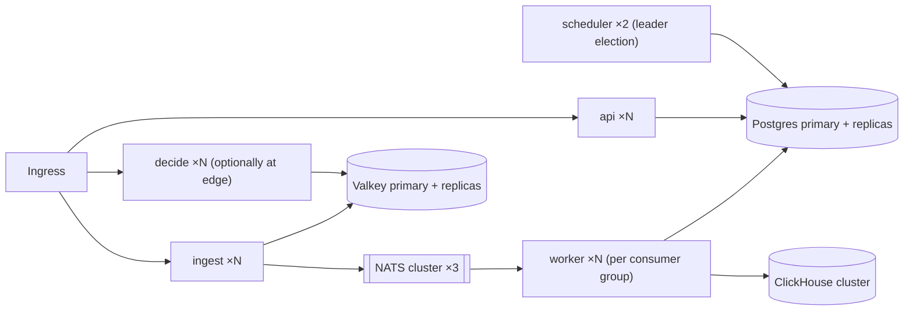

# Deployment & scaling

## 1. Self-host profiles

### "Single node" (default `docker compose up`)

- 6 containers, one VM with 4 vCPU / 16 GB RAM handles ~100k–1M profiles and hundreds of events/s.
- `app` image runs migrations on start (guarded by advisory lock), serves UI, API, MCP, ingest, decide, workers, scheduler.
- Config via env file; `cli` for admin tasks (create owner, rotate keys, backup hooks).

### "Scaled" (Kubernetes / Helm, later)

### Homelab / local (owner's first install)

- Same single-node compose file; Caddy can use local certificates (or skip TLS on a trusted LAN).
- **Public reachability:** a live website's SDK, provider webhooks and remote MCP clients need to reach `ingest`, `decide` and `/mcp`. Expose only those paths through a tunnel (e.g. Cloudflare Tunnel or Tailscale Funnel) rather than opening ports; keep the admin UI LAN/VPN-only.
- Outbound email via the configured SMTP relay; Mailpit for test sends.

## 2. Scaling path to 10M profiles

| Concern | Single node | At 10M profiles / ~5k events/s peak |
|---|---|---|
| Ingest | in `all` process | dedicated `ingest` pods, stateless; ~1–2k events/s per pod in Node → 4–6 pods |
| Bus | single NATS | 3-node JetStream cluster, subjects partitioned by `workspace` + hash(profile) for ordered per-profile processing |
| Events | single ClickHouse | single large node still feasible (~500M rows/month compressed); then 2 shards × 2 replicas with ClickHouse Keeper |
| Profiles (Postgres) | single | ~10M rows × few KB → tens of GB: fine on one primary; read replicas for analytics/UI; hash-partition `journey_participants` & `identifiers` |
| Journey steps | batched sweeper in process | more sweeper processes, then hash-partition `participants`; spike 3 measured ~45k participant transitions/s on one 4-vCPU box, far above the 10M-profile need |
| Decide | in process | dedicated pods + Valkey replicas; optional edge deployment (Hono runs on edge runtimes) with a regional Valkey |
| Email | provider-bound | 50M/month ≈ 20/s average, bursts of thousands/s → adapter rate limits + queue smoothing |

Load tests (k6, AGPL — used as an external tool, not shipped) should validate these numbers before each phase is declared done.

## 3. Path to multi-tenant SaaS

Built in from day one:
- `workspace_id` everywhere, RLS, per-workspace bus subjects & key prefixes, per-workspace encryption keys, per-workspace quotas/rate limits.
- `organization` → `workspace` hierarchy in the data model even if self-hosters only ever have one.

Added later:
- Billing/metering (events ingested, profiles, messages, LLM tokens — the metering events already exist for budgets).
- Tenant-aware noisy-neighbour protection (per-tenant consumer limits, ClickHouse quotas).
- Regional deployments (EU first), customer-managed keys, SSO/SCIM, SOC 2 controls.
- Separate "enterprise/cloud" features, if any, kept in a separately licensed directory (see [ADR-0009](adr/0009-project-license.md)).

## 4. Backups & upgrades

- Postgres: WAL-G or pgBackRest to S3; ClickHouse: `clickhouse-backup`; NATS streams are not a source of truth (replayable window only) — Valkey not backed up (rebuildable).
- Upgrades: semantic versioning, migrations are forward-only and run automatically; breaking changes to the event or artifact schemas carry versioned migrations; ClickHouse schema migrations via a small migration runner in `cli`.
