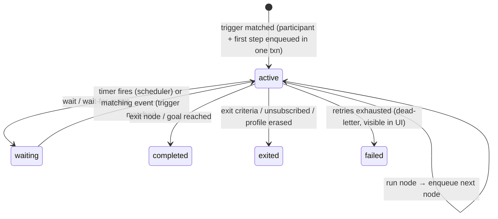

# Journeys, editors, versioning & approvals

## 1. Journey model

A journey is a **directed graph** stored as a versioned artifact (JSON). The same engine runs marketing journeys and general automations; they differ only in the node palette shown in the UI.

```json
{
  "trigger": { "type": "event", "event": "signed_up", "reentry": "once" },
  "goal":    { "event": "order_completed", "within": "P30D" },
  "nodes": {
    "n1": { "type": "send.email", "template": "tpl_welcome@3", "purpose": "onboarding", "next": "n2" },
    "n2": { "type": "wait.event", "event": "email_clicked", "timeout": "P2D",
            "next": { "matched": "n4", "timeout": "n3" } },
    "n3": { "type": "split.ab", "variants": { "a": 50, "b": 50 }, "next": { "a": "n5", "b": "n6" } },
    "n4": { "type": "ai.decide", "prompt": "prm_next_best@2", "options": ["n5", "n6", "exit"], "fallback": "n5" }
  }
}
```

### Node palette (v1)

| Category | Nodes |
|---|---|
| Triggers | event, segment entered/exited, schedule (one-off/recurring campaign), API/MCP call, date trait (birthday, renewal) |
| Flow | wait (duration / until time / send-time window), wait for event (with timeout), branch (conditions using segment DSL), A/B/n split, random sample, exit, goal |
| Actions | send email, show/enable web experience, webhook, update profile trait, add/remove list or tag, emit event |
| AI | `ai.decide` (choose branch with structured output), `ai.generate` (fill content slots) — see [agents-and-mcp.md](agents-and-mcp.md) |
| Automation (later) | HTTP request, transform (JSONata), loop over items, call integration action |

Journey settings: re-entry rule, frequency caps, quiet hours, exit criteria, goal & conversion window, purpose (lawful basis), holdout/control group %.

## 2. Journey runtime

See [ADR-0004](adr/0004-journey-runtime.md) for why this is built on Postgres + Graphile Worker instead of Temporal.

```
journey_participants(
  workspace_id, id, journey_id, journey_version_id, profile_id,
  status  -- active | waiting | completed | exited | failed
  current_node, wake_at, waiting_for_event, context jsonb, entered_at, updated_at)
journey_step_log(workspace_id, participant_id, node_id, attempt, outcome, at)  -- also streamed to ClickHouse
```



Principles:
- **Interpreter, not code generation.** The interpreter loads the pinned `journey_version_id` and executes one node per job. Every node handler is idempotent and side effects go through the send gateway with an idempotency key, so retries are safe.
- **State change + next job in one Postgres transaction** (Graphile Worker jobs live in the same database) → no lost or duplicated steps.
- **Timers:** `wake_at` is indexed; the scheduler moves due participants to the queue in batches. Long waits (30 days) cost one row, not a running process.
- **Event waits:** `(workspace_id, waiting_for_event, profile_id)` index; the trigger matcher checks incoming events against it.
- **Version pinning:** participants stay on the version they entered with. Publishing a new version affects new entrants; a later "migrate participants" tool maps old node ids to new ones.
- **Simulation:** the same interpreter runs in a dry-run mode against a sample or synthetic profile with a virtual clock — used by the UI ("preview path") and by agents (`journeys.simulate`).
- **Throughput target:** 1k–5k steps/s on a modest Postgres; partition `journey_participants` by journey hash when needed.

## 3. Journey canvas (UI)

- **React Flow (xyflow, MIT)** for the canvas: drag-and-drop nodes, auto layout (ELK.js, EPL-2.0 — or dagre, MIT), mini map, zoom.
- Node inspector forms are **generated from the node's zod schema** (zod → JSON Schema → form) so a new node type needs one schema + one handler + optional custom UI.
- Live overlays: participant counts per node, conversion per branch, errors.
- The canvas edits the same JSON the agent edits; there is no UI-only state.

## 4. Email editor & content

See [ADR-0006](adr/0006-email-format-and-editor.md).

- **Canonical format: MJML + Liquid.** MJML (MIT) gives responsive, client-safe HTML; Liquid (LiquidJS, MIT — sandboxed, no code execution) gives personalization (`{{ profile.first_name | default: "there" }}`, loops over cart items).
- **Visual editor: GrapesJS (BSD-3) with the `grapesjs-mjml` preset**, wrapped in a React component. It imports and exports MJML directly, so an agent-written MJML template opens in the visual editor and vice-versa.
- Fallback / alternative evaluated in a spike: Easy Email (MIT, React + MJML) — nicer React integration, less certain maintenance.
- **Code view** (Monaco) with MJML + Liquid, for power users and diff review.
- Content building blocks: reusable **snippets/blocks** (header, footer, product grid), **brand kit** (colors, fonts, logo), **content slots** that `ai.generate` may fill.
- Rendering pipeline: Liquid → MJML → HTML (+ plain-text alternative), link wrapping for click tracking, List-Unsubscribe headers. Rendered output cached per (template version, locale).
- Previews: test profiles, device widths, dark mode, send test; spam/accessibility lint (alt text, link checks).
- Localization: per-locale variants of a template version.

## 5. Versioning & approvals (all artifact types)

Journeys, templates, snippets, segments, experiences, AI prompts and tracking plans share one artifact system.

```
artifacts(workspace_id, id, type, name, current_published_version_id, ...)
artifact_versions(workspace_id, id, artifact_id, number, state, content jsonb, content_hash,
                  parent_version_id, author_type (user|agent|system), author_id, change_note, created_at)
approval_requests(workspace_id, id, version_id, requested_by, status, decided_by, decided_at, comment)
```

- States: `draft → in_review → approved → published → superseded/archived`. Published versions are **immutable**; references can pin a version (`tpl_welcome@3`) or follow "latest published".
- **Diffs:** structural JSON diff + rendered visual diff (email preview side-by-side, journey graph highlight).
- **Configurable approval policy per workspace** (and overridable per artifact type):

| Policy | Typical use |
|---|---|
| `none` | Single-person setup: publish directly |
| `agent_changes_require_approval` | Humans publish directly; anything authored by an agent needs a human approve |
| `publish_requires_approval` (N approvers, optional "not the author") | Teams with review process |
| `sends_above_threshold_require_approval` | Approve campaigns targeting > N recipients |

- Approvals are commands like everything else, so they can be done in the UI, via MCP (by a human-authenticated client), or later via Slack/email links.
- **Config-as-code (later):** export/import artifacts as YAML to a git repo for teams that want PR-based review.
