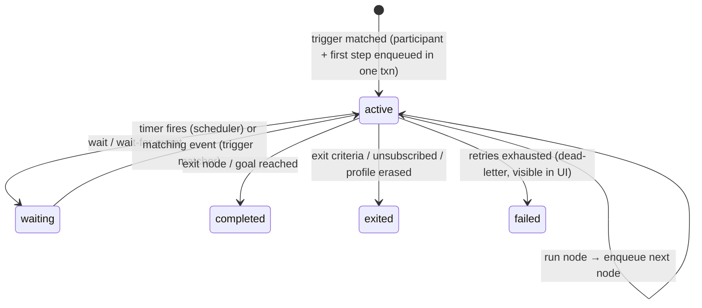

# Journeys, editors, versioning & approvals

## 1. Journey model

A journey is a **directed graph** stored as a versioned artifact (JSON). The same engine runs marketing journeys and general automations; they differ only in the node palette shown in the UI.

```json
{
  "trigger": { "type": "event", "event": "signed_up", "reentry": "once" },
  "goal":    { "event": "order_completed", "within": "P30D" },
  "nodes": {
    "n1": { "type": "send.email", "template": "tpl_welcome@3", "purpose": "onboarding", "next": "n2" },
    "n2": { "type": "wait.event", "event": "email_clicked", "timeout": "P2D",
            "next": { "matched": "n4", "timeout": "n3" } },
    "n3": { "type": "split.ab", "variants": { "a": 50, "b": 50 }, "next": { "a": "n5", "b": "n6" } },
    "n4": { "type": "ai.decide", "prompt": "prm_next_best@2", "options": ["n5", "n6", "exit"], "fallback": "n5" }
  }
}
```

### Node palette (v1)

| Category | Nodes |
|---|---|
| Triggers | event, segment entered/exited, schedule (one-off/recurring campaign), API/MCP call, date trait (birthday, renewal) |
| Flow | wait (duration / until time / send-time window), wait for event (with timeout), branch (conditions using segment DSL), A/B/n split, random sample, exit, goal |
| Actions | send email, show/enable web experience, webhook, update profile trait, add/remove list or tag, emit event |
| AI | `aiDecide` (choose branch with structured output), `aiGenerate` (fill content slots) — see [agents-and-mcp.md](agents-and-mcp.md) |
| Automation | webhook, transform (JSONata into `vars`), action (an integration action with ok/error edges); loop over items is not built |

Journey settings: re-entry rule, frequency caps, quiet hours, exit criteria, goal & conversion window, purpose (lawful basis), holdout/control group %.

## 2. Journey runtime

See [ADR-0004](adr/0004-journey-runtime.md) for why this is built on Postgres, with the participants table as a batched queue, instead of Temporal or one job per step.

```
journey_participants(
  workspace_id, id, journey_id, journey_version_id, profile_id,
  status  -- active | waiting | completed | exited | failed
  current_node, wake_at, waiting_for_event, context jsonb, entered_at, updated_at)
journey_step_log(workspace_id, participant_id, node_id, attempt, outcome, at)  -- also streamed to ClickHouse
```



Principles:
- **Interpreter, not code generation.** The interpreter loads the pinned `journey_version_id` and executes one node per job. Every node handler is idempotent and side effects go through the send gateway with an idempotency key, so retries are safe.
- **Batched claims, one transaction:** sweepers claim due participants with `FOR UPDATE SKIP LOCKED`, advance them in memory and write states plus outbox rows in one transaction → no lost or duplicated steps (crash-tested in spike 3).
- **Timers:** `wake_at` is indexed; the scheduler moves due participants to the queue in batches. Long waits (30 days) cost one row, not a running process.
- **Event waits:** `(workspace_id, waiting_for_event, profile_id)` index; the trigger matcher checks incoming events against it.
- **Version pinning:** participants stay on the version they entered with. Publishing a new version affects new entrants; `journeys.migrate` moves people still on an older version onto the published one (dry run first, with an old-node to new-node mapping).
- **Simulation:** the same interpreter runs in a dry-run mode against a sample or synthetic profile with a virtual clock — used by the UI ("preview path") and by agents (`journeys.simulate`).
- **Throughput target:** 1k–5k steps/s on a modest Postgres; partition `journey_participants` by journey hash when needed.

### Bulk enrollment by segment (#148)

`journeys.enroll` takes at most 1,000 profile ids per call, which makes a migrated list awkward: a client has to page ids and keep state. `journeys.enrollSegment {artifactId, segmentId, limit?, reason, idempotencyKey?}` enrolls a published segment instead and returns a job id. It is the deliberate backfill path; event and segment-entry triggers keep handling ongoing entry.

- **The job.** `enrollment_jobs` (migration `0060_enrollment_jobs.sql`) records the journey, segment, status (`queued`, `running`, `done`, `failed`, `cancelled`), the optional `limit`, the cursor (the last profile id scanned), entered/skipped/failed counts and a skip-reason summary (`reentry`, `no_profile`, `no_lawful_basis`, `suppressed`, `no_address`, …). `journeys.enrollmentJob` and `journeys.enrollmentJobs` show it; `journeys.cancelEnrollment` stops a queued or running job. People already enrolled stay in the journey.
- **Chunks and resume.** The scheduler scans the segment's memberships in chunks of 500, ordered by profile id, and commits each chunk's participants and its cursor in one transaction. A crash loses at most the chunk in flight; the next tick resumes after the cursor. Entry keys are deterministic (`bulk:<job>:<profile>`), so a retried chunk cannot enroll the same person twice.
- **Per-person gates.** Before someone enters, the same rules as `journeys.enroll` apply: the trigger's re-entry rule (`once`, `after_exit`, `always`), an existing (non-merged) profile, and consent plus suppression for the journey's first channel (e-mail, then SMS, then push) under the journey's purpose. Consent withdrawn before their chunk is processed means they are skipped, not enrolled and exited later.
- **Who may run it.** The impact is the segment's people capped by `limit`, with the journey's touches plus the segment, so the policy engine and a mandate's scope see the audience. Above the workspace's audience threshold an agent is refused with the reason (the command is not approvable, like `journeys.enroll`); a person can run it. The job keeps who requested it and the reason, and the agent ledger records the decision.
- **The count.** The job's `people` is the audience estimate at request time (the segment capped by `limit`). A dynamic segment enrolls its current memberships, so run `segments.refresh` (or wait for the scheduler) after changing its rule or publishing it.

## 3. Journey canvas (UI)

- **React Flow (xyflow, MIT)** for the canvas: drag-and-drop nodes, auto layout (ELK.js, EPL-2.0 — or dagre, MIT), mini map, zoom.
- Node inspector forms are **generated from the node's zod schema** (zod → JSON Schema → form) so a new node type needs one schema + one handler + optional custom UI.
- Live overlays: participant counts per node, conversion per branch, errors.
- The canvas edits the same JSON the agent edits; there is no UI-only state.

## 4. Email editor & content

See [ADR-0006](adr/0006-email-format-and-editor.md).

- **Canonical format: MJML + Liquid.** MJML (MIT) gives responsive, client-safe HTML; Liquid (LiquidJS, MIT — sandboxed, no code execution) gives personalization (`{{ profile.first_name | default: "there" }}`, loops over cart items).
- **Visual editor: GrapesJS (BSD-3) with the `grapesjs-mjml` preset**, wrapped in a React component. It imports and exports MJML directly, so an agent-written MJML template opens in the visual editor and vice-versa. [Spike 2](../../spikes/email-editor/FINDINGS.md) showed this needs a thin adapter: expand self-closing `mj-*` tags before import, unescape entities inside Liquid tags on export, and treat `mj-table` as a code-only block. With that, agent-written templates round-trip pixel-identical.
- **Save-time guards:** every save from the visual editor is checked against the previous version: Liquid tokens must be unchanged unless the person edited them, and the MJML must validate. A save that would silently drop or corrupt Liquid is blocked.
- Easy Email (MIT) was evaluated and rejected: it drops `mj-preview`/`mj-title` and overrides the template's styles with its own defaults on import.
- **Code view** (Monaco) with MJML + Liquid, for power users and diff review.
- Content building blocks: reusable **snippets/blocks** (header, footer, product grid), **brand kit** (colors, fonts, logo), **content slots** that `ai.generate` may fill.
- Rendering pipeline: Liquid → MJML → HTML (+ plain-text alternative), link wrapping for click tracking, List-Unsubscribe headers. Rendered output cached per (template version, locale).
- Previews: test profiles, device widths, dark mode, send test; spam/accessibility lint (alt text, link checks).
- Localization: per-locale variants of a template version.

## 5. Versioning & approvals (all artifact types)

Journeys, templates, snippets, segments, experiences, AI prompts and tracking plans share one artifact system.

```
artifacts(workspace_id, id, type, name, current_published_version_id, ...)
artifact_versions(workspace_id, id, artifact_id, number, state, content jsonb, content_hash,
                  parent_version_id, author_type (user|agent|system), author_id, change_note, created_at)
approval_requests(workspace_id, id, version_id, requested_by, status, decided_by, decided_at, comment)
```

- States: `draft → in_review → approved → published → superseded/archived`. Published versions are **immutable**; references can pin a version (`tpl_welcome@3`) or follow "latest published".
- **Diffs:** structural JSON diff + rendered visual diff (email preview side-by-side, journey graph highlight).
- **Configurable approval policy per workspace** (and overridable per artifact type):

| Policy | Typical use |
|---|---|
| `none` | Single-person setup: publish directly |
| `agent_changes_require_approval` | Humans publish directly; anything authored by an agent needs a human approve |
| `publish_requires_approval` (N approvers, optional "not the author") | Teams with review process |
| `sends_above_threshold_require_approval` | Approve campaigns targeting > N recipients |

- Approvals are commands like everything else, so they can be done in the UI, via MCP (by a human-authenticated client), or later via Slack/email links.
- **Config-as-code:** `config.export` / `config.import` move every artifact of a workspace as one JSON bundle, starting as a dry run and publishing in dependency order. `scripts/am-config.mjs` keeps one file per artifact in a git repository for PR-based review.
