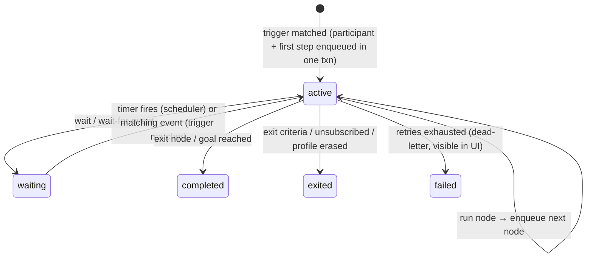

# Journeys, editors, versioning & approvals

## 1. Journey model

A journey is a **directed graph** stored as a versioned artifact (JSON). The same engine runs marketing journeys and general automations; they differ only in the node palette shown in the UI.

```json
{
  "purpose": "onboarding",
  "goal": "order_completed",
  "nodes": [
    { "id": "n1", "kind": "trigger", "label": "Signed up",
      "config": { "event": "signed_up", "reentry": "once" }, "next": [{ "to": "n2" }] },
    { "id": "n2", "kind": "email", "label": "Welcome",
      "config": { "template": "eml_0123456789abcdef0123456789abcdef" }, "next": [{ "to": "n3" }] },
    { "id": "n3", "kind": "waitEvent", "label": "Wait for a click",
      "config": { "event": "Email Link Clicked", "timeout": "P2D" },
      "next": [{ "to": "n4" }, { "to": "n5" }] },
    { "id": "n4", "kind": "split", "label": "Two follow-ups",
      "config": { "weights": [50, 50] }, "next": [{ "to": "n5" }, { "to": "n6" }] },
    { "id": "n5", "kind": "aiDecide", "label": "Pick the next step",
      "config": { "prompt": "prm_0123456789abcdef0123456789abcdef", "options": ["continue", "exit"], "fallback": "continue" },
      "next": [{ "to": "n6" }, { "to": "n7" }] },
    { "id": "n6", "kind": "goal", "label": "Order completed",
      "config": { "event": "order_completed", "within": "P30D" } },
    { "id": "n7", "kind": "exit", "label": "Exit", "config": {} }
  ]
}
```

### Node palette (v1)

| Category | Nodes |
|---|---|
| Triggers | event, segment entered/exited, schedule (one-off/recurring campaign), API/MCP call, date trait (birthday, renewal) |
| Flow | wait (duration / until time / send-time window), wait for event (with timeout), branch (conditions using segment DSL), A/B/n split, random sample, exit, goal |
| Actions | send email, show/enable web experience, webhook, update profile trait, add/remove list or tag, emit event |
| AI | `aiDecide` (choose branch with structured output), `aiGenerate` (fill content slots), `decision` (one typed question to a decision provider, compared with a threshold) — see [agents-and-mcp.md](agents-and-mcp.md) and [decision-models.md](../decision-models.md) |
| Automation | webhook, transform (JSONata into `vars`), action (an integration action with ok/error edges); loop over items is not built |

Journey settings: re-entry rule, frequency caps, quiet hours, exit criteria, goal & conversion window, purpose (lawful basis), holdout/control group %.

## 2. Journey runtime

See [ADR-0004](adr/0004-journey-runtime.md) for why this is built on Postgres, with the participants table as a batched queue, instead of Temporal or one job per step.

```
journey_participants(
  workspace_id, id, journey_id, journey_version_id, profile_id,
  status  -- active | waiting | completed | exited | failed
  current_node, wake_at, waiting_for_event, context jsonb, entered_at, updated_at)
journey_step_log(workspace_id, participant_id, node_id, attempt, outcome, at)  -- also streamed to ClickHouse
```



Principles:
- **Interpreter, not code generation.** The interpreter loads the pinned `journey_version_id` and executes one node per job. Every node handler is idempotent and side effects go through the send gateway with an idempotency key, so retries are safe.
- **Batched claims, one transaction:** sweepers claim due participants with `FOR UPDATE SKIP LOCKED`, advance them in memory and write states plus outbox rows in one transaction → no lost or duplicated steps (crash-tested in spike 3). The journey step, split and goal events go out through the same outbox (one row per journey) with retries, so a ClickHouse outage delays the reports instead of losing a take or a conversion (#1244); a transient read failure leaves the participant due after a short backoff and fails it only when its retries are spent (#1240).
- **Timers:** `wake_at` is indexed; the scheduler moves due participants to the queue in batches. Long waits (30 days) cost one row, not a running process.
- **Event waits:** `(workspace_id, waiting_for_event, profile_id)` index; the trigger matcher checks incoming events against it.
- **One event, one entry (#1011, #1052):** the post-resolve hook writes an event's enrolment and the wake-up of the people already waiting for it in one transaction under the workspace identity lock, and records the event and the person it was applied to in `journey_processed_events` (migration `0109_journey_processed_events.sql`). Delivery is at-least-once, so this is what stops a redelivered event from enrolling a person twice after they exited, from waking a wait that its own delivery created, or from satisfying a later wait or goal on the same event name (#1052). An event that neither enrols nor wakes anybody writes no row. A marker is the person's row too — an erasure removes it, and retention prunes it 30 days after the event was applied (`JOURNEY_EVENT_RETENTION_DAYS`).
- **Delivery age (#1027):** because the marker is pruned, the hook only applies an event while the delivery is young enough for that marker to exist. An event older than 7 days by its receive time (`receivedAt`), or more than 5 minutes in the future (a clock problem, not a fresh delivery), is refused. `JOURNEY_EVENT_MAX_AGE_DAYS` and `JOURNEY_EVENT_RETENTION_DAYS` are defined together in `packages/db/src/idempotency.ts`, and the hook asserts at startup that the bound is strictly smaller than the retention. The gap (23 days) covers a skewed process clock, a late retention tick and a replay after a multi-day outage. A refused event is acknowledged, logged at debug level without its event id (a caller-supplied id can name a person) and counted in `am_journey_events_too_old_total`, which is per process; the durable signal is the `queue.outbox` check in `am doctor`.
  - **What is refused.** Enrolment, and the wakes the event itself would cause: `waitEvent` and `goal` participants, and the early `waitUntil` recheck the hook runs for the batch. A `waitUntil` condition can still be satisfied at the next sweep from the event store, which is that node's normal semantics.
  - **One clock for both outbox kinds.** A `message_event` outbox row stores the time it was queued and the dispatcher publishes its carrier events with it; rows written before that field existed fall back to the row's `created_at`, never to now. A `segment_change` row already carries the events as written. `am outbox` resets a row's attempts, never its receive time, so requeueing cannot make an old trigger young again.
  - **The trade-off.** A stream or outbox backlog older than the bound permanently drops the journey triggers in it: they are refused when they are finally delivered, and requeueing does not revive them. `am doctor`'s `queue.outbox` check names the rows once they pass the bound, and the recovery for segment-entry journeys is `journeys.enrollSegment`.
  - **The age is the server's receive time.** It is `receivedAt`, the server's own receive time, not the event's `timestamp`. The timestamp is the sender's, clamped to no later than receipt, and it may be deliberately historical; the receive time is written at ingest and every redelivery carries it unchanged, which is what says how long the event has been in flight.
  - **Imports and backfills still enrol.** An import of an old signup carries a historical `timestamp` but a fresh `receivedAt`, so the bound does not see it as old. `journeys.enroll` and `journeys.enrollSegment` write participants directly in their own transaction rather than through the hook, so no event age applies to them; the segment-entry events that maintain membership carry the time they were realised.
  - **Replays inside the bound keep their dedup.** A redelivery younger than the bound is still stopped by its marker, which is what the bound is for.
- **Version pinning:** participants stay on the version they entered with. Publishing a new version affects new entrants; `journeys.migrate` moves people still on an older version onto the published one (dry run first, with an old-node to new-node mapping).
- **Simulation:** the same interpreter runs in a dry-run mode against a sample or synthetic profile with a virtual clock — used by the UI ("preview path") and by agents (`journeys.simulate`).
- **Split and holdout results:** `journeys.splitResult` (0.6.0) reports, for a split node, the people in each arm, their goal conversions and unsubscribes, and each arm against the first with lift, a 95% interval and a verdict that needs the minimum sample in both arms. Each entry counts at most one conversion and unsubscribe. A conversion's recorded participant is canonical across profile merges and must have its own split take at or before the conversion; a missing, too-late or bypassing entry is not credited to another participant (#419). Only an outcome without a participant, such as an e-mail unsubscribe, falls back to the profile's latest entry at or before it, with participant id breaking timestamp ties. A repeated split take keeps the participant's first arm, so a re-entrant cannot count one conversion in every arm (#369). `journeys.holdoutResult` does the same for a journey's control group. Both are computed on demand from journey events, not stored.
- **Throughput target:** 1k–5k steps/s on a modest Postgres; partition `journey_participants` by journey hash when needed.

### Bulk enrollment by segment (#148)

`journeys.enroll` takes at most 1,000 profile ids per call, which makes a migrated list awkward: a client has to page ids and keep state. `journeys.enrollSegment {artifactId, segmentId, limit?, reason, idempotencyKey?}` enrolls a published segment instead and returns a job id. It is the deliberate backfill path; event and segment-entry triggers keep handling ongoing entry.

- **The job.** `enrollment_jobs` (migrations `0060_enrollment_jobs.sql` and `0061_enrollment_job_versions.sql`) records the journey, segment, the pinned `journey_version` and `segment_version`, status (`queued`, `running`, `done`, `failed`, `cancelled`), the optional `limit`, the cursor (the last profile id scanned), entered/skipped/failed counts and a skip-reason summary (`reentry`, `no_profile`, `no_lawful_basis`, `suppressed`, `no_address`, …). `journeys.enrollmentJob` and `journeys.enrollmentJobs` show it, including the pinned versions and, when the job stopped, the reason in `error`; `journeys.cancelEnrollment` stops a queued or running job. People already enrolled stay in the journey.
- **Version pinning.** A job records the journey's and the segment's published versions when it is created, and every participant enters that pinned journey version. Before each chunk the scheduler re-reads both artifacts: if the journey or the segment was republished, archived or unpublished mid-flight, the job stops as `failed` with a clear reason (for example “The journey was republished (v1 → v2) during the enrollment; start a new job to enroll the rest into v2.”) instead of mixing versions or continuing with a retired segment. A job created before this pinning (no versions recorded) keeps today's behaviour for its first chunk and pins then.
- **Chunks and resume.** The scheduler scans the segment's memberships in chunks of 500, ordered by profile id, and commits each chunk's participants and its cursor in one transaction. A crash loses at most the chunk in flight; the next tick resumes after the cursor. Entry keys are deterministic (`bulk:<job>:<profile>`), so a retried chunk cannot enroll the same person twice.
- **Per-person gates.** Before someone enters, the same rules as `journeys.enroll` apply: the trigger's re-entry rule (`once`, `after_exit`, `always`), an existing (non-merged) profile, and consent plus suppression for the journey's first channel (e-mail, then SMS, then push) under the journey's purpose. Consent withdrawn before their chunk is processed means they are skipped, not enrolled and exited later.
- **Who may run it.** The impact is the segment's people capped by `limit`, with the journey's touches plus the segment, so the policy engine and a mandate's scope see the audience. Above the workspace's audience threshold an agent is refused with the reason (the command is not approvable, like `journeys.enroll`); a person can run it. The job keeps who requested it and the reason, and the agent ledger records the decision.
- **The count.** The job's `people` is the audience estimate at request time (the segment capped by `limit`). A dynamic segment enrolls its current memberships, so run `segments.refresh` (or wait for the scheduler) after changing its rule or publishing it.

## 3. Journey canvas (UI)

- **React Flow (xyflow, MIT)** for the canvas: drag-and-drop nodes, the platform's own layered auto-layout ([journey/layout.ts](../../apps/web/src/features/journey/layout.ts)) that places nodes by distance from the trigger and siblings side by side, with a stored position always winning, plus mini map and zoom.
- Node inspector forms are **generated from the node's zod schema** (zod → JSON Schema → form) so a new node type needs one schema + one handler + optional custom UI.
- Live overlays: participant counts per node, conversion per branch, errors.
- The canvas edits the same JSON the agent edits; there is no UI-only state.

## 4. Email editor & content

See [ADR-0006](adr/0006-email-format-and-editor.md).

- **Canonical format: MJML + Liquid.** MJML (MIT) gives responsive, client-safe HTML; Liquid (LiquidJS, MIT — sandboxed, no code execution) gives personalization (`{{ profile.first_name | default: "there" }}`, loops over cart items).
- **Visual editor: GrapesJS (BSD-3) with the `grapesjs-mjml` preset**, wrapped in a React component. It imports and exports MJML directly, so an agent-written MJML template opens in the visual editor and vice-versa. [Spike 2](../../spikes/email-editor/FINDINGS.md) showed this needs a thin adapter: expand self-closing `mj-*` tags before import, unescape entities inside Liquid tags on export, and treat `mj-table` as a code-only block. With that, agent-written templates round-trip pixel-identical.
- **Save-time guards:** every save from the visual editor is checked against the previous version: Liquid tokens must be unchanged unless the person edited them, and the MJML must validate. A save that would silently drop or corrupt Liquid is blocked.
- Easy Email (MIT) was evaluated and rejected: it drops `mj-preview`/`mj-title` and overrides the template's styles with its own defaults on import.
- **Code view**: the MJML/Liquid editor's code tab is a plain monospaced `Textarea`, with read-only diffs and previews in a copyable `<pre>` — no Monaco or CodeMirror bundle.
- Content building blocks: reusable **snippets/blocks** (header, footer, product grid), **brand kit** (colors, fonts, logo), **content slots** that `ai.generate` may fill.
- Rendering pipeline: Liquid → MJML → HTML (+ plain-text alternative), link wrapping for click tracking, List-Unsubscribe headers. Rendered output cached per (template version, locale).
- Previews: test profiles, device widths, dark mode, send test; spam/accessibility lint (alt text, link checks).
- Localization: per-locale variants of a template version.

## 5. Versioning & approvals (all artifact types)

Journeys, templates, snippets, segments, experiences, AI prompts and tracking plans share one artifact system.

```
artifacts(workspace_id, id, type, name, current_published_version_id, ...)
artifact_versions(workspace_id, id, artifact_id, number, state, content jsonb, content_hash,
                  parent_version_id, author_type (user|agent|system), author_id, change_note, created_at)
approval_requests(workspace_id, id, version_id, requested_by, status, decided_by, decided_at, comment)
```

- States: `draft → in_review → approved → published → superseded/archived`. Published versions are **immutable**. A reference names an artifact by its id (`eml_…`, `seg_…`, `prm_…`) and uses its published version; there is no `@version` suffix. A campaign records the approved `briefId` and `briefVersion` it was built from.
- **Diffs:** structural JSON diff + rendered visual diff (email preview side-by-side, journey graph highlight).
- **Configurable approval policy per workspace** (and overridable per artifact type):

| Policy | Typical use |
|---|---|
| `none` | Single-person setup: publish directly |
| `agent_changes_require_approval` | Humans publish directly; anything authored by an agent needs a human approve |
| `publish_requires_approval` (N approvers, optional "not the author") | Teams with review process |
| `sends_above_threshold_require_approval` | Approve campaigns targeting > N recipients |

- Approvals are commands like everything else, so they can be done in the UI, via MCP (by a human-authenticated client), or later via Slack/email links.
- **Config-as-code:** `config.export` / `config.import` move every artifact of a workspace as one JSON bundle, starting as a dry run and publishing in dependency order. `scripts/am-config.mjs` keeps one file per artifact in a git repository for PR-based review.
