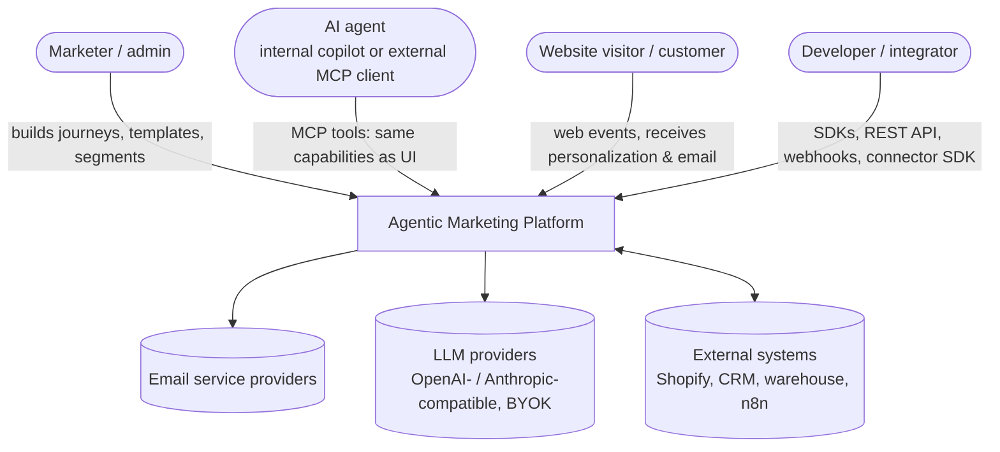
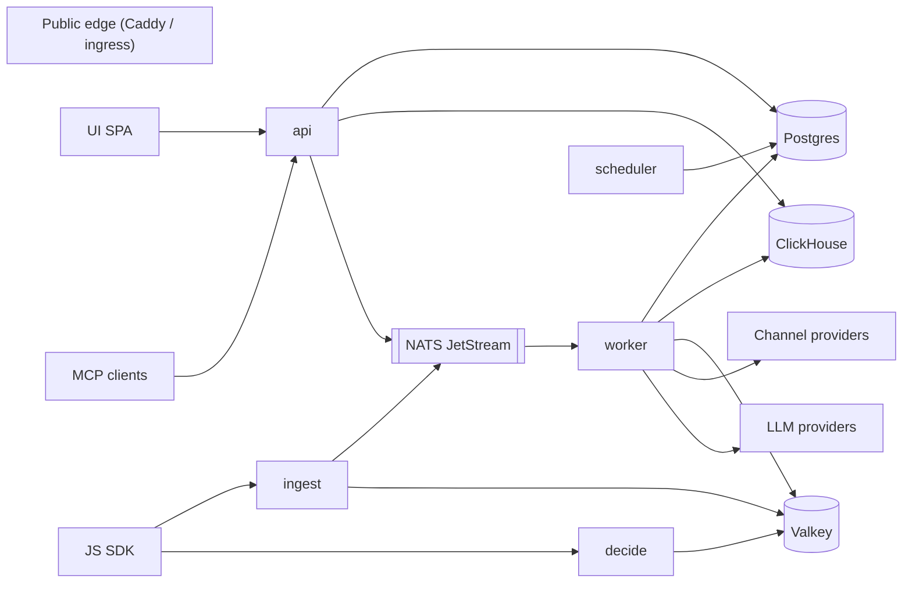
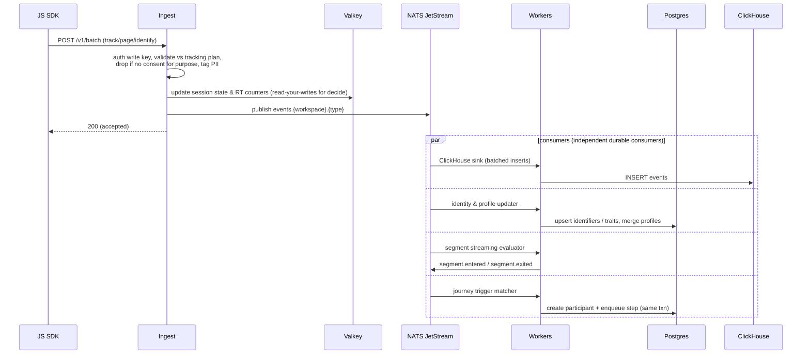
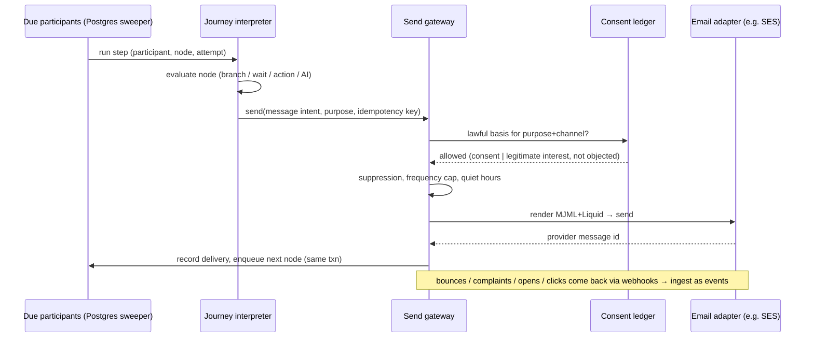
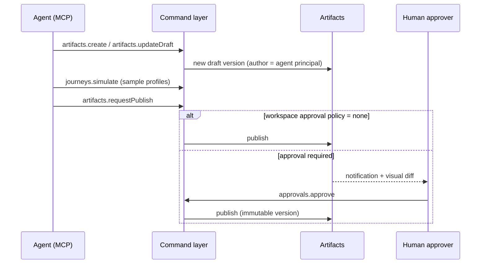

# System overview

## 1. System context



## 2. Containers (runtime roles)

The platform is **one codebase and one container image**. A `ROLE` env var (or several, comma-separated) selects which modules a process runs. On a small install a single process runs all roles; at scale each role is deployed and scaled independently.

| Role | Responsibility | Latency class | Scales by |
|---|---|---|---|
| `api` | Command layer: REST, MCP (streamable HTTP), UI RPC, auth, static UI | interactive (<300 ms) | users / agents |
| `ingest` | Event intake (Segment-spec HTTP API), validation, consent filter, identity hints, session-state update, publish to bus | hot path (<20 ms p95) | events/s |
| `decide` | Web personalization decision API, reads hot state from Valkey | hot path (<50 ms p95) | page views/s |
| `worker` | Bus consumers: ClickHouse sink, profile updater, segment evaluator, journey trigger matcher; journey step execution; sends | near real time (<5 s) | events/s, journey steps/s |
| `scheduler` | Timers (journey waits, scheduled segment recomputes, campaign schedules), maintenance jobs | seconds | singleton (leader-elected) |



## 3. Module boundaries (inside the monolith)

Modules communicate through **typed in-process interfaces and bus events**, never by reaching into each other's tables. This keeps the option of extracting a module into its own service later.

```
packages/
  core/            # ids, errors, canonical JSON hashing, time and network helpers
  db/              # SQL migrations and runner, Drizzle schema, owner and RLS pools
  commands/        # command registry: defineCommand(), authz, idempotency, audit
  artifacts/       # versioned artifacts, approvals, diffs, bundles, holdouts, hosted pages
  secrets/         # envelope encryption, key providers, write-only secret commands
  auth/            # Better Auth, OAuth 2.1 for MCP clients, members, SSO/SCIM, API tokens
  telemetry/       # pino logger, optional OpenTelemetry tracing
  events/          # NATS bus, ClickHouse event store and sink, event schemas
  ingest/          # Segment-compatible ingest gateway, source keys, consent policy
  hotstate/        # Valkey session and profile snapshot for the decision API
  profiles/        # profiles, identity resolution, consent ledger, per-person encryption
  segments/        # segment DSL, SQL compiler, streaming evaluator, static lists, snapshots, CSV
  journeys/        # journey graph model, interpreter, entry keys, wait-until, control groups
  audience/        # signup forms, broadcasts, hosted pages, archive, import, message events, retention
  email/           # send gateway, e-mail/SMS/push adapters, templates, blocks, checks, delivery policy
  campaigns/       # campaign members, shared UTM campaign, control-group helpers
  personalize/     # experiences, decision engine, A/B allocation and results, edge decide
  analytics/       # read-only metric layer: query catalogue, named reports, campaign summary
  alerts/          # threshold alert rules, five-minute evaluator, notifications
  ai/              # LLM gateway and providers, prompt tests, AI steps, copilot, context and redaction
  ads/             # ad platform connectors and conversions, audience sync, click ids, spend import
  integrations/    # connections, connector SDK, webhooks, OAuth, egress guard, Shopify import
  assets/          # image and PDF asset library, SVG cleaning, PNG renditions, asset routes
  warehouse/       # warehouse export datasets and destinations
  client/          # typed REST client inferred from the command registry
  edge-worker/     # the decision API as a Cloudflare Worker
  sdk-js/          # browser SDK: tracking, consent banner, personalization and push
apps/
  server/          # composes modules into roles (api, ingest, decide, worker, scheduler)
  web/             # React admin UI (app shell and router, ui, features, pages) and the demo
```

## 4. Key data flows

### 4.1 Web event → journey trigger (near real time)



### 4.2 Journey step → message



### 4.3 Agent edits a journey



## 5. Cross-cutting conventions

- **Tenancy:** every table has `workspace_id` (plus `organization_id` reserved for SaaS); every bus subject and ClickHouse row carries it. Postgres Row Level Security is enabled from day one so a missed `WHERE` cannot leak data across workspaces.
- **IDs:** UUIDv7 (time ordered, index friendly) everywhere; external-facing IDs prefixed (`jrn_`, `tpl_`, `prf_`).
- **Idempotency:** every command and every side effect accepts an idempotency key; the send gateway deduplicates on `(participant, node, attempt-group)`.
- **Outbox:** state changes that must emit bus events write to an outbox table in the same transaction; a relay publishes to NATS. No dual writes.
- **Time:** all timestamps UTC; per-profile timezone trait used for send-time and quiet hours.
- **Observability:** OpenTelemetry traces/metrics/logs from every role; trace context propagated through bus messages and queue jobs.
